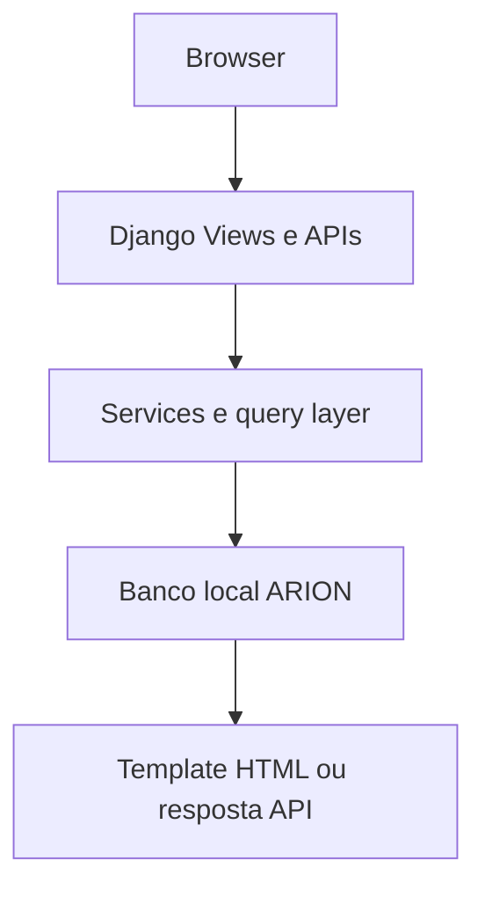
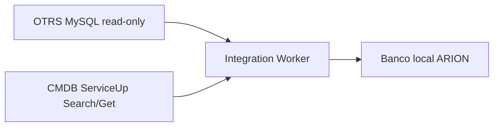
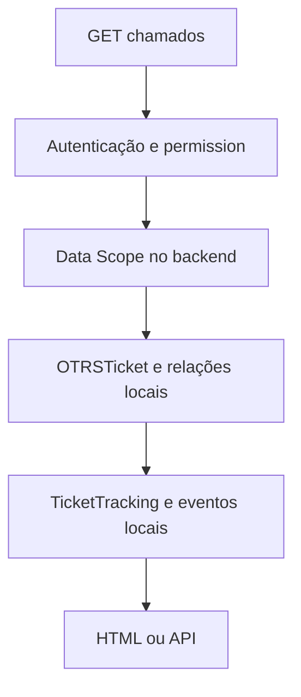
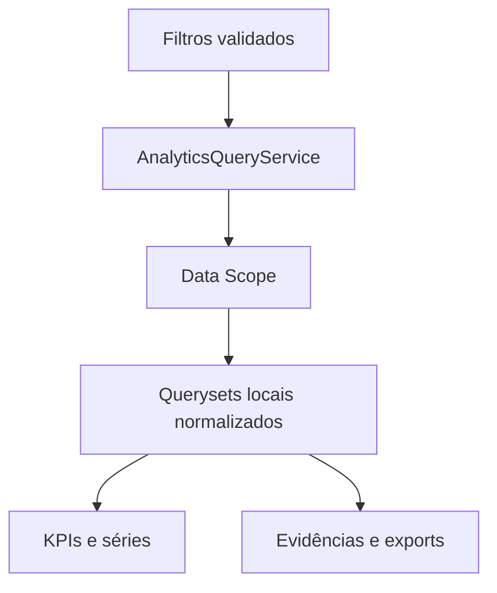
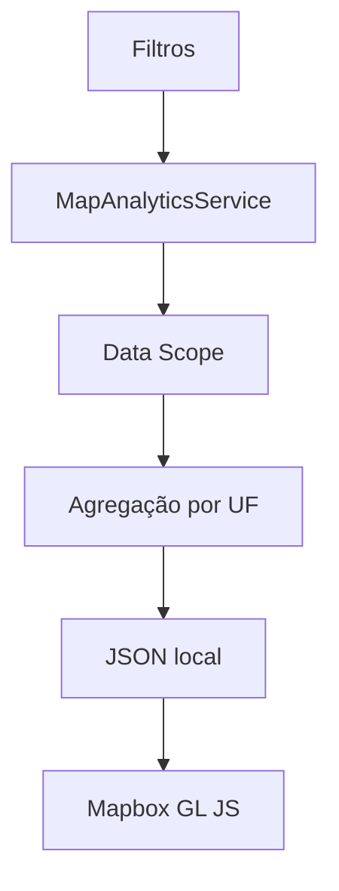
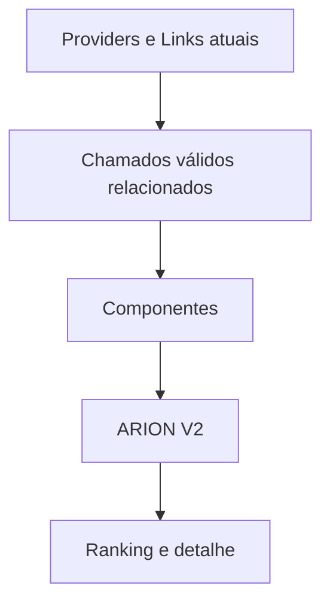
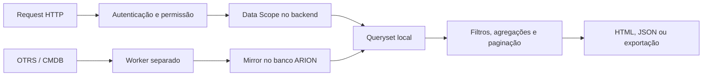

# Arquitetura do ARION ATACADO GEO

## Limite entre request e sincronização

Uma request web consulta dados locais. A sincronização é um processo separado: o worker lê as fontes oficiais e aplica snapshots no banco ARION. Essa separação mantém as telas independentes da latência do OTRS e do CMDB.

### Caminho da request

### Caminho de sincronização

O banco local é ao mesmo tempo estado próprio do produto, cache dos mirrors e base analítica. OTRS e CMDB continuam como registros oficiais nos seus domínios; o ARION não envia alterações de volta.

> **Fonte da verdade:** OTRS é oficial para ticket e seu estado; CMDB é oficial para ConfigItems, Links e Providers. O mirror ARION atende consulta e análise operacional e pode ficar stale até a próxima sincronização.

## Apps Django instalados

| App | Tipo | Responsabilidade | Models principais | Serviços e entradas |
|---|---|---|---|---|
| `autenticacao` | Core | Login, sessão e páginas de acesso | User Django | forms, views, urls |
| `configuracoes` | Administração | Preferências, RBAC, Data Scope e documentação | `UserPreference`, `GroupDataScope`, `LegacyUserDataScope` | `access_control.py`, `data_scope.py`, views/forms |
| `auditoria` | Administração | Histórico de eventos relevantes | `AuditEvent` | `AuditService`, views |
| `integracoes` | Integração | Clients, execução de sync e mirrors CMDB/OTRS | `Integration`, `IntegrationRun`, `IntegrationSyncState`, `IntegrationLease`, mirrors | clients, services e management commands |
| `chamados` | Operacional | Fila e acompanhamento local | `TicketTracking`, `TicketTrackingNote`, `TicketTrackingEvent`, `TicketQueueView` | services, forms, views/API |
| `base_links` | Operacional e compatibilidade | Consulta atual de links; também mantém models antigos e dimensões usadas pelo escopo | mirrors consultados pela Base; `Operadora`, `Projeto`; models legados | query services, views |
| `painel` | Analytics | Dashboard, Cockpit e consultas analíticas | `SavedAnalyticsView` | `services/analytics.py`, views/APIs |
| `mapa` | Analytics | Agregações por UF e modos geográficos | Sem model de domínio próprio | `services/analytics.py`, views |
| `rankings` | Analytics | Rankings e exportações | Sem model de domínio próprio | `services.py`, `performance.py`, `exports.py` |
| `ari` | Produto | Conversas e artefatos Preview | `AriConversation`, `AriMessage`, `AriAttachment`, `AriArtifact` | services de conversa, simulação e arquivos |

As pastas `projetos`, `relatorios` e `importacoes` existem no repositório, mas não estão em `INSTALLED_APPS` na configuração atual.

## Fluxos protegidos

### Chamados

O mirror OTRS é leitura. Ações da tela alteram somente acompanhamento local, notas, eventos ou preferências de fila. `TicketTracking.ticket_external_id` aponta pelo valor externo OTRS e é unique, mas não é uma ForeignKey ao mirror.

### Cockpit e analytics

Os filtros não substituem a autorização. Data Scope entra no queryset antes de filtros analíticos, agregação, paginação e exportação. O dashboard e o Cockpit consultam o mesmo conceito/fonte quando o indicador é compartilhado.

### Mapa

O Mapa agrega dados do mirror e não geocodifica endereços ou chama CMDB por request.

### Rankings

Ranking usa a dimensão Provider/ISP do CMDB mirror. Data Scope é aplicado antes dos recortes e cálculos. Os componentes, universo e limites de interpretação estão em [Ranking de Provedores](funcionalidades/rankings.md).

## Matriz de módulos e dados

| Módulo | Dados locais consultados | Escrita local | Consulta OTRS/CMDB durante request |
|---|---|---|---|
| Dashboard e Cockpit | Tickets, estado e relações OTRS; Links/Providers CMDB conforme o indicador | Views analíticas salvas no Cockpit | Não |
| Mapa | Links CMDB, tickets OTRS e relação Ticket–CI para agregações geográficas | Não | Não |
| Rankings | Links/Providers CMDB e tickets/relações OTRS no período selecionado | Não | Não |
| Base | Link/Provider CMDB e relações/tickets OTRS em detalhes de histórico | Não; ações administrativas próprias de importação são legado | Não |
| Chamados | Tickets/relações OTRS, Links/Providers CMDB, acompanhamento e histórico ARION | Tracking, notas, eventos e filas pessoais | Não |
| Administração e acesso | User, Group, Permission, escopos, preferências, integrações e auditoria | Formulários administrativos e services correspondentes | Não |
| ARI | Conversas, mensagens, anexos e artefatos locais | Services ARI e storage associado | Não |

Os conjuntos variam por tela e indicador; a tabela registra as famílias centrais, não um contrato de que cada view leia todas as tabelas citadas. Veja também [Dashboard](funcionalidades/dashboard.md), [Cockpit](funcionalidades/cockpit.md), [Mapa](funcionalidades/mapa.md), [Rankings](funcionalidades/rankings.md), [Base](funcionalidades/base.md) e [Chamados](funcionalidades/chamados.md).

## Request, escopo e performance

RBAC determina a ação disponível; Data Scope limita as linhas no backend. `LinkQueryService.base(user)` aplica o recorte de Operadora/Projeto antes de filtros, agregações, rankings, contadores e paginação. Em `CUSTOM`, Operadora e Projeto se combinam por interseção; não são uma união. `LegacyUserDataScope` permanece no schema por compatibilidade histórica, mas a resolução ativa do `DataScopeService` usa escopos de Groups. Permissão de menu ou filtro do navegador não substitui a checagem backend. Superuser técnico tem escopo global.

Cada request trabalha com o banco local e consulta serviços/ORM. Latência ou indisponibilidade da fonte remota afeta freshness após uma falha do Worker, não bloqueia a tela aguardando OTRS/CMDB. Para schema/ownership e dados persistidos, veja [Banco de Dados](BANCO-DE-DADOS.md); para cadências e recuperação, [Worker](WORKER-E-SINCRONIZACAO.md).

## Camadas

- **Models e migrations:** schema local, constraints, relações e evolução do banco.
- **Clients:** transporte e adaptação da origem; OTRS read-only e CMDB GenericInterface de leitura.
- **Services:** sincronização, identidade de negócio, Data Scope, analytics, auditoria e acompanhamento local.
- **Views/APIs:** autenticação/autorização, validação, coordenação e resposta HTML/JSON/arquivo.
- **Forms:** validação de entrada; não substituem autorização backend.
- **Templates:** interface Django server-rendered e componentes reutilizáveis.
- **Static CSS/JS:** tokens de tema e comportamento em CSS/JavaScript vanilla.
- **Management commands:** worker e operações controladas de manutenção/sincronização.
- **Tests:** verificação de services, views, permissões e integridade por app.

## Identidade, acesso e banco

`LinkBusinessIdentityService` interpreta o nome original CMDB e mantém separados o texto de origem e os campos derivados, com confiança e origem. Provider/ISP vem da entidade CMDB relacionada. Cliente e Projeto derivados não são campos oficiais independentes confirmados pelo CMDB.

RBAC define ações via Django Groups/Permissions. Data Scope define as linhas consultáveis e é imposto no backend. Em modo CUSTOM, Operadora e Projeto formam interseção. Superuser técnico continua global.

O banco local suporta SQLite e MySQL. Seleção, schema e cardinalidades estão em [Banco de Dados e Modelos](BANCO-DE-DADOS.md); fontes, ownership e limites do mirror estão em [Fontes de Dados](FONTES-DE-DADOS.md). Worker, cadências e recuperação estão em [Worker e Sincronização](WORKER-E-SINCRONIZACAO.md).

## Interfaces

Templates são renderizados por Django; CSS fica em `static/` e os fontes JavaScript ficam em `frontend_src/`, fora da coleta estática de produção. Em development, o template tag `` serve as fontes; em production, serve apenas bundles de `static/arion_build/`, gerados pelo pipeline Node sem source maps. A Central de Documentação, como as outras telas, reutiliza o sistema atual de tema claro/escuro. Os models XLSX e snapshots antigos permanecem documentados por compatibilidade; sua presença no schema não os torna fonte atual da Base.
