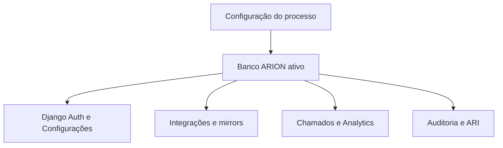
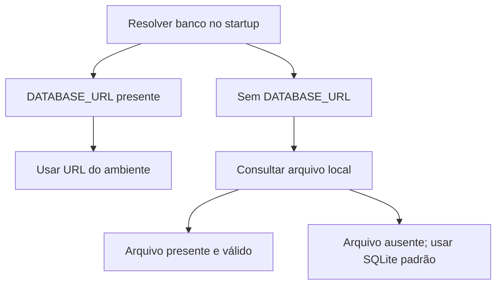
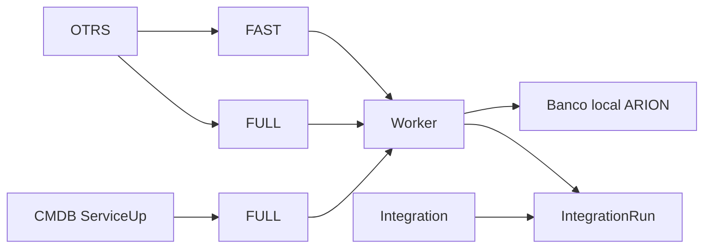
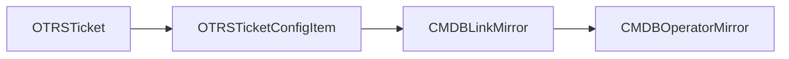
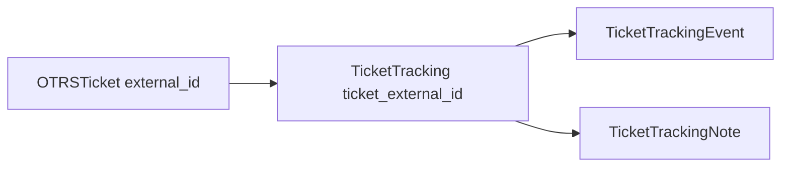
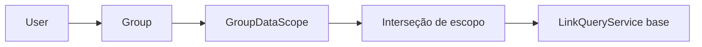
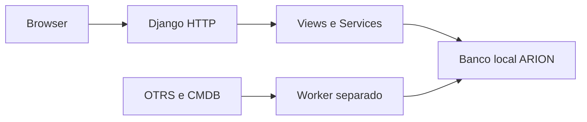
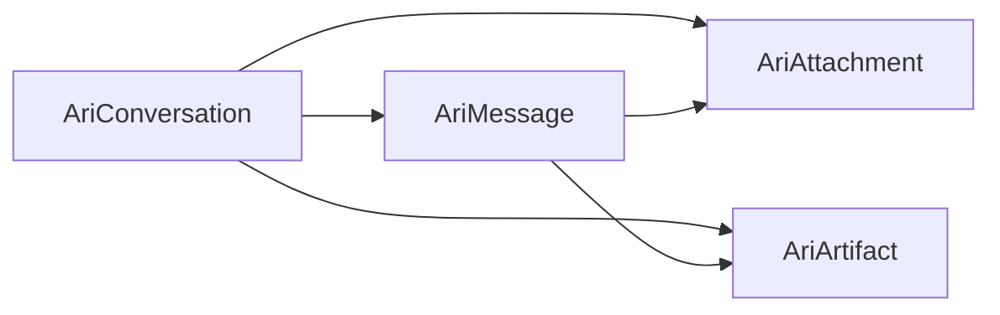
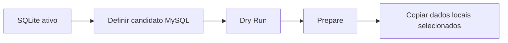
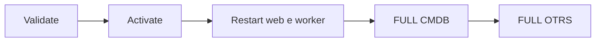

# Banco de Dados e Modelos

{{badge:ARION}} {{badge:LOCAL}} {{badge:MIRROR}} {{badge:PERSISTENTE}}

## Visão do banco ARION

O banco ativo pode ser MySQL ou SQLite. É o schema da aplicação Django: contém dados próprios (usuários, preferências, tracking, auditoria e analytics salvos) e mirrors locais lidos das fontes oficiais. A fonte oficial do Ticket continua OTRS e a do ConfigItem continua CMDB.

## Navegação rápida

[Visão geral](#visao-do-banco-arion) · [Domínios](#propriedade-dos-dados-e-ciclo-de-vida) · [ERDs](#erds-por-dominio) · [Catálogo visual](#catalogo-navegavel-de-models) · [OTRS](OTRS.md) · [CMDB](CMDB.md) · [Chamados](funcionalidades/chamados.md) · [Índices](#indices-que-atendem-consultas-operacionais) · [Backup](#backup-e-restore) · [SQLite → MySQL](#migracao-sqlite-mysql) · [Troubleshooting](#troubleshooting-do-banco)



O inventário abaixo é baseado em models instalados e mantidos no código; as quantidades não consultam banco em request.

| Domínio | Models do projeto | Relações principais |
|---|---:|---|
| Core Django/Auth | 5 modelos Django instalados | User–Group, User–Permission e Group–Permission N:N; sessões e content types |
| Integrações e sync | 4 | Integration 1:N IntegrationRun; SyncState e Lease têm chave própria por fonte |
| OTRS mirror | 3 | OTRSTicket 1:N relação Ticket–CI; StateMapping independente |
| CMDB mirror | 2 | Link N:1 opcional Provider/ISP |
| Chamados | 4 | Tracking 1:N notas e eventos; QueueView por usuário |
| Configurações e escopo | 3 | GroupDataScope 1:1 Group; escopo M:N Operadora/Projeto |
| Auditoria | 1 | AuditEvent → User opcional |
| Analytics salvo | 1 | SavedAnalyticsView → User |
| ARI | 4 | Conversation 1:N Message/Attachment/Artifact |
| Base legada e dimensões | 6 | Import–Link–Change e dimensões Operadora/Projeto |

> **Fonte da verdade:** OTRS continua sendo o registro oficial de tickets; CMDB continua sendo o registro oficial de ConfigItems e Providers. Os models `OTRSTicket`, `OTRSTicketConfigItem`, `CMDBLinkMirror` e `CMDBOperatorMirror` são cópias locais de leitura para a operação.

## Seleção do banco



Precedência real: `DATABASE_URL`; depois configuração local em `ARION_DATABASE_CONFIG` ou no caminho padrão `var/database-config.json`; quando o arquivo não existe, o bootstrap inicial seleciona SQLite em `arion_geo/db.sqlite3`. Arquivo presente mas inválido gera erro de configuração; não é ignorado para cair silenciosamente em SQLite. O arquivo fica fora do repositório por padrão. Quando `DATABASE_URL` está definida, comandos de ativação/rollback do arquivo local são recusados.

A estrutura atual está na versão 2 e contém `version`, `active`, `candidate`, `rollback` e `migration`. Config de conexão tem `engine`, `database`, `host`, `port`, `user`, `password_protected` e `timeout`. Exemplo sanitizado, sem credenciais ou endereços:

```json
{
  "version": 2,
  "active": {
    "engine": "<engine>",
    "database": "<nome omitido>",
    "host": "<omitido>",
    "port": 0,
    "user": "<omitido>",
    "password_protected": "<valor protegido omitido>",
    "timeout": 10
  },
  "candidate": null,
  "rollback": null,
  "migration": {}
}
```

Os valores `<...>` e o `port` numérico são placeholders de formato, não valores de conexão.

A senha protegida é material local de configuração, não deve ser copiada para documentação, frontend, logs ou comandos compartilhados. Em Windows, a proteção DPAPI fica vinculada ao usuário do processo.

## ERDs por domínio

### Execuções e estado de integração



`IntegrationRun.integration` é FK obrigatória `CASCADE`. `IntegrationSyncState` e `IntegrationLease` são registros separados identificados por `key`; o service os associa à fonte por convenção, não por ForeignKey a `Integration`.

### Ticket → CI → Provider



OTRSTicket → OTRSTicketConfigItem é FK 1:N. `OTRSTicketConfigItem.cmdb_link` e `CMDBLinkMirror.operator` são nullable, `SET_NULL`, cada uma N:1 para o model local de destino. `config_item_id` armazena o `ConfigItemID` externo como chave textual, correlacionado com `CMDBLinkMirror.source_config_item_id`; não é FK. `source_number` / CMDB `Number` é identificador de apresentação e não é chave de join. `OTRSStateMapping.external_state_id` é chave única usada na normalização, sem FK para a tabela remota.

### Chamados



O vínculo entre `TicketTracking.ticket_external_id` e `OTRSTicket.external_id` é lógico por valor, unique local, sem FK. Notas e eventos são filhos 1:N. `TicketQueueView` é outra preferência ligada diretamente ao User.

### RBAC e Data Scope



User–Group é N:N pelas relações intermediárias Django; `GroupDataScope.group` é 1:1 e `CASCADE`. `allowed_operators` e `allowed_projects` são N:N por tabelas intermediárias. `LinkQueryService.base(user)` aplica os escopos antes dos filtros, da paginação e dos cálculos; no modo CUSTOM, Operadora e Projeto são interseccionados. `LegacyUserDataScope` segue como compatibilidade. As permissões RBAC continuam separadas do filtro de linhas.

### Fluxo da aplicação



**Requests HTTP não consultam OTRS/CMDB remotamente.** O Worker separado lê as origens e persiste o snapshot no banco ARION; as views continuam lendo o último estado local.

### Analytics salvo


Cada Saved View pertence a um usuário; `(user, name)` é único.

### ARI



Conversation possui mensagens, anexos e artefatos; Attachment e Artifact também têm FK para a Message que os originou. Exclusões de conversa/mensagem seguem as relações `CASCADE` documentadas nos models.

## Cardinalidade, constraints e exclusão

| Relação ou chave | Cardinalidade | Constraint/nullable | Exclusão |
|---|---|---|---|
| `Integration` → `IntegrationRun` | 1:N | FK obrigatória | `CASCADE` remove as execuções ao apagar a Integration |
| `OTRSTicket` → `OTRSTicketConfigItem` | 1:N | FK obrigatória; unique `(ticket, config_item_id, relation_type)` | `CASCADE` |
| `OTRSTicketConfigItem` → `CMDBLinkMirror` | N:1 opcional | FK nullable | `SET_NULL`; mantém a relação de origem |
| `CMDBLinkMirror` → `CMDBOperatorMirror` | N:1 opcional | FK nullable | `SET_NULL`; mantém o Link |
| `Group` → `GroupDataScope` | 1:1 | OneToOne unique | `CASCADE` |
| GroupDataScope → Operadora/Projeto | N:N | tabelas intermediárias; valores permitidos | rows intermediárias acompanham a exclusão |
| User → `UserPreference` | 1:1 | OneToOne unique | `CASCADE` |
| User → `TicketTracking` por responsável/autor da atualização | 1:N opcional | duas FKs nullable | `SET_NULL` |
| `TicketTracking` → Note/Event | 1:N | FKs obrigatórias | `CASCADE` |
| Note → User autor | N:1 obrigatório | FK obrigatória | `PROTECT`; não apaga histórico de autoria |
| Event → User ator | N:1 opcional | FK nullable | `SET_NULL` |
| User → `TicketQueueView` | 1:N | unique `(user, name)` | `CASCADE` |
| User → `SavedAnalyticsView` | 1:N | unique `(user, name)` | `CASCADE` |
| User → `AuditEvent` | 1:N opcional | FK nullable | `SET_NULL` |
| User → Group | N:N | tabelas padrão Django | intermediários geridos pelo Django |

Nos models de domínio listados aqui não há `CheckConstraint` nem `unique_together` no estado atual. Há `UniqueConstraint` para relação Ticket–CI, nome de TicketQueueView por usuário e nome de SavedAnalyticsView por usuário. Campos `null=True` aceitam SQL NULL; `blank=True` afeta validação/formulário e não define nulabilidade do banco.

## Índices que atendem consultas operacionais

| Model | Campo(s) / índice | Motivo |
|---|---|---|
| `OTRSTicket` | `external_id`, `ticket_number` unique | Upsert/lookup e link operacional |
| `OTRSTicket` | `otrsticket_queue_present_idx(queue_external_id, is_present_in_queue)` | Fila atual e reconciliação |
| `OTRSTicket` | `otrsticket_status_date_idx(business_status, source_created_at)` | Status por coorte de criação |
| `OTRSTicketConfigItem` | `uniq_ticket_ci_relation_type(ticket, config_item_id, relation_type)` | Deduplicação da relação de origem |
| `OTRSTicketConfigItem` | `ticketci_ticket_seen_idx(ticket, is_present_in_source)` | Relações correntes por ticket |
| `OTRSTicketConfigItem` | `ticketci_link_seen_idx(cmdb_link, is_present_in_source)` | Relações atuais por Link |
| `CMDBLinkMirror` | `linkmirror_operator_idx(operator, is_present_in_source)` | Links atuais por Provider |
| `CMDBLinkMirror` | `linkmirror_state_city_idx(state, city)` | Agregação geográfica |
| `CMDBLinkMirror` | `linkmirror_project_idx(legacy_project, is_present_in_source)` | Fallback legado de projeto |
| `CMDBOperatorMirror` | `opmirror_name_present_idx(name, is_present_in_source)` | Busca/nome de Provider atual |
| `TicketTracking` | `tracking_status_idx`, `tracking_assignee_idx`, `tracking_updated_idx`, `tracking_next_action_idx` | Fila operacional e próximos passos |
| `TicketTrackingNote/Event` | `(tracking, created_at)` | Histórico cronológico por acompanhamento |
| `IntegrationRun` | FKs/índices de integration, status, started_at, request_id, triggered_by | Diagnóstico e histórico de execução |
| `IntegrationLease` | unique `key`, índice `expires_at` | Aquisição e recuperação do lock |
| `AuditEvent` | timestamp, user, category, action, result, module | Pesquisa paginada de auditoria |

Os nomes e campos da tabela acima vêm de models/migrations; os motivos são inferidos dos querysets e dos fluxos atuais. Não há benchmark, `EXPLAIN` ou medição de seletividade registrado aqui. Campos unique geram índice do banco mesmo que `db_index=False`; a coluna da tabela de schema mostra o atributo explícito `db_index`. Índices compostos e constraints são exibidos junto de cada model abaixo. Não adicione índices só por intuição: confronte o queryset e o plano no backend operacional.

## Migração SQLite → MySQL

### Preparar cópia



### Ativar e reconstruir



Comandos suportados pelo management command:

```powershell
.venv\Scripts\python.exe arion_geo\gerenciar.py migrar_banco_arion --target=mysql --dry-run
.venv\Scripts\python.exe arion_geo\gerenciar.py migrar_banco_arion --target=mysql --prepare
.venv\Scripts\python.exe arion_geo\gerenciar.py migrar_banco_arion --target=mysql --copy-local-data
.venv\Scripts\python.exe arion_geo\gerenciar.py migrar_banco_arion --target=mysql --validate
.venv\Scripts\python.exe arion_geo\gerenciar.py migrar_banco_arion --target=mysql --activate
```

`--copy-local-data` faz backup consistente do SQLite e copia modelos locais selecionados. Resumo confirmado em `arion_database_migration.py`:

| Categoria | Copia? | Observação |
|---|---|---|
| Django Users, Groups, permissões e memberships | Sim | Cópia por chaves naturais configuradas no serviço |
| `Operadora`, `Projeto`, Group/Legacy Data Scope e tabelas M2M | Sim | Preserva opções e escopos locais |
| `UserPreference`, `SavedAnalyticsView` | Sim | Preferências e views salvas |
| `Integration` | Sim | Configuração; secret cifrado é re-protegido via DPAPI. Status/conectividade são reiniciados conforme serviço |
| `AuditEvent` | Sim | Deduplicação pelo fingerprint usado pelo migrador |
| Chamados e filas pessoais | Não | `TicketTracking`, Notes, Events e `TicketQueueView` não constam na whitelist de cópia; não aparecem no candidato |
| ARI persistido | Não | Conversas, mensagens, anexos e artefatos não constam na whitelist |
| Base legacy | Não | Models do importador XLSX não constam na whitelist |
| CMDB/OTRS mirrors | Não | Links, Providers, tickets e relações são limpos no candidato; `OTRSStateMapping` também não é transferido |
| Worker/runtime state | Não | `IntegrationRun`, `IntegrationSyncState`, `IntegrationLease` não são transferidos |

O migrador copia explicitamente User, Group, dimensões Operadora/Projeto, scopes e relações M:N, preferência, SavedAnalyticsView, Integration e AuditEvent; também mapeia permissions/memberships necessários. Rows selecionadas atualizam destino por chaves naturais; tabelas M:N evitam duplicatas e AuditEvent usa fingerprint. A cópia roda em transação no candidato. Um username existente com hash de senha divergente interrompe a cópia para resolução explícita. Ela é idempotente para os mesmos registros/chaves, mas **não** transforma a base candidata em espelho completo: linhas locais de destino fora do conjunto copiado não são apagadas.

Fora da whitelist, TicketTracking, notas/eventos, TicketQueueView, dados ARI e models legacy continuam no arquivo SQLite de origem; eles não ficam no MySQL ativado. Faça backup íntegro e estabeleça uma transferência específica antes da troca quando esses dados existirem. O backup automático do migrador é uma fotografia consistente SQLite em `var/backups/db-before-mysql-<timestamp>.sqlite3` antes da cópia; ele só se aplica quando a origem ativa é SQLite e não substitui backup institucional, retenção nem teste de restore.

Validação e ativação são etapas distintas. Depois de ativar, reinicie web e worker; confira as configurações de Integration e reconstrua os mirrors com FULL CMDB e FULL OTRS. O migrador não lê/escreve em OTRS nem CMDB para completar a cópia. O segredo de Integration é aberto e protegido novamente via DPAPI no processo atual; a conta Windows que fará a migração/restauração precisa conseguir reabrir esse material ou os conectores devem ser reconfigurados.

Schema, dados e backend são operações diferentes: `migrate` aplica migrations Django no candidato; `--copy-local-data` transfere o subconjunto local descrito acima; `--activate` seleciona o candidato para os próximos processos; FULL consulta origens e cria mirrors. Nenhuma dessas etapas substitui automaticamente as outras.

> **Atenção:** rollback escolhe a configuração anterior salva ou, se o banco atual é MySQL e `arion_geo/db.sqlite3` existe, usa esse SQLite como fallback. Ele troca a configuração ativa e exige reinício dos processos. Não copia alterações recentes do MySQL de volta para SQLite; o schema MySQL permanece. Mirrors no banco de destino podem estar ausentes ou antigos e devem ser reconstruídos por FULL após confirmar a origem.

```powershell
.venv\Scripts\python.exe arion_geo\gerenciar.py migrar_banco_arion --target=mysql --rollback
```

`DATABASE_URL` impede ativação/rollback por arquivo local. Consulte `integracoes/services/arion_database_migration.py`, `integracoes/services/arion_database.py` e o comando antes de uma operação autorizada. Este documento não contém parâmetros reais de conexão.

`DATABASE_URL` tem precedência e bloqueia ativação/rollback da configuração local. Rollback seleciona o banco anterior e exige reiniciar processos; não replica alterações MySQL para SQLite. Consulte [Implantação e Produção](IMPLANTACAO-E-PRODUCAO.md) antes de uma mudança autorizada.

## Backup e restore

{{badge:PERSISTENTE}} {{badge:SEGURANÇA}} {{badge:RECONSTRUÍVEL}}

Mirrors OTRS/CMDB podem ser refeitos das origens, mas backup regular é do banco local completo. A cópia remota não recupera notas, eventos, escopos, permissões, configurações, auditoria, views salvas, dados ARI ou histórico legacy.

| Classe | Exemplos | Tratamento |
|---|---|---|
| Reconstruível de fonte oficial | OTRS/CMDB mirrors e mapping OTRS | FULL controlado após restore/ativação; snapshot válido antes de marcar ausências |
| Persistente ARION | usuários, groups/grants, Data Scope, preferências, Chamados, notas/eventos, auditoria, analytics salvos e ARI | Incluir no backup íntegro; não presumir reconstrução |
| Configuração local protegida | arquivo de configuração do banco e secrets de Integration | Backup restrito; DPAPI é vinculada ao usuário Windows que protegeu o valor; manter contexto de restore ou reconfigurar |
| Runtime e histórico de sync | IntegrationRun, cursor/state, lease | Preservar com o backup completo; cursor/lease podem ser recriados, retenção de runs não tem política definida neste repositório |

Checklist de operação:

1. Gere backup consistente, com acesso restrito e proteção de acordo com a política local.
2. Verifique integridade/legibilidade e registre banco, escopo e timestamp, sem anotar secrets.
3. Aplique retenção definida pela organização e mantenha cópia fora do host do banco.
4. Execute restore test periódico em ambiente isolado, valide migrations, contagens, permissões e leitura de dados ARION.
5. Registre resultado/data do restore test e faça FULL de OTRS/CMDB somente depois de validar as origens e o destino.

Restaurar uma cópia do banco não restaura por si só arquivos externos do ARI nem o contexto DPAPI de outra conta Windows; faça inventário de storage de arquivos e do usuário de serviço conforme o deployment.

## Models legados e de compatibilidade

{{badge:LEGACY}}

Os estados abaixo descrevem o uso visível no código atual, não uma recomendação de remoção. Nenhuma tabela desta lista deve ser removida sem análise de referências, migração de dados e plano de compatibilidade.

| Model | Estado | Uso encontrado | Pode remover? |
|---|---|---|---|
| `CMDBImport` | LEGACY | Criado pelo service XLSX legado e exposto no admin; não é fonte atual da Base | Não avaliado |
| `CMDBLink` | LEGACY | Escrito pelo importador antigo e referenciado pelo agregador legado; uso em requests atuais não confirmado | Não avaliado |
| `CMDBLinkChange` | LEGACY | Histórico gravado pelo importador antigo e exposto no admin | Não avaliado |
| `Provider` | COMPATIBILITY | Target da FK do `CMDBLink` legado e do agregador antigo | Não avaliado |
| `Operadora` | ACTIVE | Dimensão usada por opções e escopo de acesso | Não; confirmar migração funcional |
| `Projeto` | ACTIVE | Dimensão usada por opções e escopo de acesso | Não; confirmar migração funcional |

O mirror operacional atual da Base é `CMDBLinkMirror`/`CMDBOperatorMirror`. A tabela legada não se torna fonte atual apenas por permanecer instalada.

## Catálogo navegável de models

### Integrações

[Integration](#integration) · [IntegrationRun](#integrationrun) · [IntegrationSyncState](#integrationsyncstate) · [IntegrationLease](#integrationlease)

### OTRS e CMDB

[OTRSTicket](#otrsticket) · [OTRSTicketConfigItem](#otrsticketconfigitem) · [OTRSStateMapping](#otrsstatemapping) · [CMDBLinkMirror](#cmdblinkmirror) · [CMDBOperatorMirror](#cmdboperatormirror)

### Chamados

[TicketTracking](#tickettracking) · [TicketTrackingNote](#tickettrackingnote) · [TicketTrackingEvent](#tickettrackingevent) · [TicketQueueView](#ticketqueueview)

### Acesso, auditoria e analytics

[GroupDataScope](#groupdatascope) · [LegacyUserDataScope](#legacyuserdatascope) · [UserPreference](#userpreference) · [AuditEvent](#auditevent) · [SavedAnalyticsView](#savedanalyticsview)

### ARI

[AriConversation](#ariconversation) · [AriMessage](#arimessage) · [AriAttachment](#ariattachment) · [AriArtifact](#ariartifact)

## Propriedade dos dados e ciclo de vida

### Matriz de ownership e backup

| Domínio | Fonte oficial / dono | Cópia local | Escrita ARION | Reconstruível | Deve entrar no backup |
|---|---|---|---|---|---|
| Tickets | OTRS | `OTRSTicket` | Worker | Sim, via FULL OTRS | Sim; backup padrão é do banco completo |
| Relações Ticket–CI | OTRS | `OTRSTicketConfigItem` | Worker | Sim, via FULL OTRS | Sim; embora reconstruível |
| Mapeamento de estados OTRS | Catálogo de estados OTRS + regra de normalização ARION | `OTRSStateMapping` | Worker | Sim, via sync OTRS | Sim, como parte do backup completo |
| Links e Providers | CMDB | `CMDBLinkMirror` e `CMDBOperatorMirror` | Worker | Sim, via FULL CMDB validado | Sim; backup padrão é do banco completo |
| Status, prioridade, responsável e próxima ação ARION | ARION | `TicketTracking` | Usuário autorizado via service | Não | Sim; obrigatório |
| Notas e eventos de Chamados | ARION | `TicketTrackingNote` e `TicketTrackingEvent` | Usuário autorizado / service | Não | Sim; obrigatório, com controles de acesso e retenção |
| Usuários, grupos, permissions e memberships | ARION / Django | `auth_user`, `auth_group` e tabelas associativas | Django Auth / administração autorizada | Não | Sim; obrigatório |
| Data Scope e dimensões permitidas | ARION | `GroupDataScope` ativo; `LegacyUserDataScope` legado; `Operadora` e `Projeto` | Administração autorizada | Não | Sim; obrigatório |
| Preferências e filas salvas | ARION | `UserPreference` e `TicketQueueView` | Usuário | Não | Sim |
| Auditoria | ARION | `AuditEvent` | `AuditService` | Não | Sim; retenção operacional definida pela organização |
| Analytics salvos e dados ARI persistidos | ARION | `SavedAnalyticsView` e models `Ari*` | Usuário / services | Não | Sim |
| Configuração de conectores | ARION, configuração local | `Integration` e arquivo local de banco | Administração autorizada | Não; secrets podem requerer reconfiguração se mudar o usuário DPAPI | Sim, com proteção e contexto de restauração |
| Execuções, cursor e lease do worker | Estado operacional ARION | `IntegrationRun`, `IntegrationSyncState` e `IntegrationLease` | Worker / commands | Runs não; cursor e lease podem ser recriados por FULL e expiração | Incluídos no backup completo; não são transferidos pela migração |
| Importações e models legacy | ARION / artefatos XLSX históricos | `CMDBImport`, `CMDBLink`, `CMDBLinkChange` e `Provider` antigos | Importador legado | Não pelo sync CMDB atual | Sim antes de limpeza ou migração, se houver dados que devam ser preservados |

Mirrors são reconstruíveis; acompanhamentos, notas, eventos, escopos, permissões, preferências, auditoria, dados salvos do Cockpit/ARI e configurações locais não são substituídos por um FULL remoto.

### Fichas de ciclo de vida dos models

O catálogo de campos físico abaixo funciona junto desta matriz: os links apontam para as fichas com tipo, nulabilidade, unicidade, índices e relações. “Reconstruível” significa que a informação pode ser lida novamente de uma fonte ou recriada pelo código; não significa que o backup seja dispensável.

| Model / conjunto | Ownership e origem | Escrita local | Reconstrução e migração SQLite → MySQL | Consumidores / fonte no repositório |
|---|---|---|---|---|
| [User](#catalogo-de-tabelas-fisicas), [Group](#catalogo-de-tabelas-fisicas), Permission e associações M:N | Identidade ARION e grants Django | Django Auth e administração autorizada | Não reconstruível como conjunto de usuários/grants; cópia transfere users, groups, permissions atribuídas e memberships | Autenticação, RBAC, auditoria e todos os módulos; Django contrib auth |
| ContentType e associações de content type | Catálogo técnico Django | Migrations e registro dos models instalados | Recriado pelo schema/migrations; referências de permissões também são validadas pelo migrador | Django Auth, admin e permissions; Django contrib contenttypes |
| Session | Sessão web temporária ARION | Middleware de sessão Django | Efêmera; a cópia seletiva não a transfere | Login HTTP; Django contrib sessions |
| [GroupDataScope](#groupdatascope), tabelas M:N, [LegacyUserDataScope](#legacyuserdatascope) | Configuração ARION de autorização por linhas; LegacyUserDataScope é estrutura histórica | Formulários administrativos de Groups/escopos | Não reconstruível; migrador copia registros e relações M:N de ambos | O DataScopeService ativo consulta escopos de Groups; `configuracoes/models.py` e `configuracoes/data_scope.py` |
| [UserPreference](#userpreference) | Preferência de conta ARION | Usuário autenticado | Não reconstruível; transferida pelo migrador | Tema e experiência global; `configuracoes/models.py` |
| [Operadora](#catalogo-de-tabelas-fisicas) e [Projeto](#catalogo-de-tabelas-fisicas) | Catálogo local usado no Data Scope; não são cópias oficiais independentes de cliente/projeto CMDB | Administração/dimensões existentes | Não reconstruídos pelo CMDB FULL; transferidos por chave normalizada | Formulários de escopo e integração de dados; `base_links/models.py` |
| [Integration](#integration) | Configuração local dos conectores | Central de Integrações | Backup obrigatório; migrador transfere a configuração selecionada e reprotege secret com DPAPI | Worker e comandos; `integracoes/models.py`, `services/arion_database.py` |
| [IntegrationRun](#integrationrun) | Histórico local de execução | Worker e comandos de integração | Histórico não é reconstruído nem copiado; retenção não está definida como contrato | Diagnóstico de sync; `integracoes/models.py`, comandos de integração |
| [IntegrationSyncState](#integrationsyncstate) e [IntegrationLease](#integrationlease) | Cursor, freshness agregada e coordenação transitória | Worker e lock de sincronização | Não copiados; FULL repovoa o estado de sincronização e leases abandonados expiram | Scheduler/diagnóstico; `integracoes/services/sync_lock.py` e `management/commands/integration_worker.py` |
| [OTRSTicket](#otrsticket), [OTRSTicketConfigItem](#otrsticketconfigitem), [OTRSStateMapping](#otrsstatemapping) | Mirror da fonte oficial OTRS | `OTRSSyncService`, apenas no banco ARION | Reconstruíveis por OTRS FAST/FULL; não transferidos pela migração; executar FULL depois da ativação | Chamados, analytics e relationships Ticket–CI; `integracoes/services/otrs_sync.py` |
| [CMDBLinkMirror](#cmdblinkmirror), [CMDBOperatorMirror](#cmdboperatormirror) | Mirror da fonte oficial CMDB | `CMDBSyncService`, apenas no banco ARION | Reconstruíveis por CMDB FULL validado; não transferidos pela migração | Base, Mapa, Rankings, Chamados e escopo; `integracoes/services/cmdb_sync.py` |
| [TicketTracking](#tickettracking), [TicketTrackingNote](#tickettrackingnote), [TicketTrackingEvent](#tickettrackingevent) | Acompanhamento, notas e histórico ARION | Usuário autorizado via `TicketTrackingService` | Não reconstruíveis e não incluídos na cópia SQLite→MySQL atual; backup/exportação planejada é obrigatória antes da troca se houver dados | Chamados; `chamados/models.py` e `chamados/services.py` |
| [TicketQueueView](#ticketqueueview) | Filtros pessoais salvos ARION | Usuário com permissão de gestão da fila | Não reconstruível e não incluído na cópia SQLite→MySQL atual | Chamados; `chamados/models.py` |
| [AuditEvent](#auditevent) | Histórico administrativo local | `AuditService` | Não reconstruível; incluído na cópia atual com deduplicação por fingerprint | Administração e trilha de auditoria; `auditoria/models.py` e `auditoria/services.py` |
| [SavedAnalyticsView](#savedanalyticsview) | Consulta analítica pessoal ARION | Usuário autenticado | Não reconstruível; transferida por usuário e nome | Cockpit; `painel/models.py` e `painel/views.py` |
| [AriConversation](#ariconversation), [AriMessage](#arimessage), [AriAttachment](#ariattachment), [AriArtifact](#ariartifact) | Conversas, mensagens e arquivos persistidos ARION | Usuário e services do ARI | Não reconstruíveis e não incluídos na cópia SQLite→MySQL atual | ARI; `ari/models.py` e services do app |
| CMDBImport, CMDBLink, CMDBLinkChange, Provider legados | Histórico e modelo antigo de importação XLSX | Importador legado; uso de request atual não confirmado | Não reconstruídos pelo mirror CMDB e não transferidos pela cópia atual; preservar no backup completo antes de qualquer limpeza/migração | Compatibilidade/importador legado; `base_links/models.py` e `base_links/services/cmdb/sync.py` |

O migrador inclui explicitamente os models listados na seção [SQLite → MySQL](#migracao-sqlite-mysql); a coluna acima registra o comportamento observado no código atual, não a intenção de um fluxo futuro.

## Catálogo de tabelas físicas

| App/model Django | Tabela física |
|---|---|
| `auth.User` | `auth_user` |
| `auth.Group` | `auth_group` |
| `auth.Permission` | `auth_permission` |
| `contenttypes.ContentType` | `django_content_type` |
| `sessions.Session` | `django_session` |
| `integracoes.Integration` | `integracoes_integration` |
| `integracoes.IntegrationRun` | `integracoes_integrationrun` |
| `integracoes.IntegrationSyncState` | `integracoes_integrationsyncstate` |
| `integracoes.IntegrationLease` | `integracoes_integrationlease` |
| `integracoes.OTRSTicket` | `integracoes_otrsticket` |
| `integracoes.OTRSTicketConfigItem` | `integracoes_otrsticketconfigitem` |
| `integracoes.OTRSStateMapping` | `integracoes_otrsstatemapping` |
| `integracoes.CMDBLinkMirror` | `integracoes_cmdblinkmirror` |
| `integracoes.CMDBOperatorMirror` | `integracoes_cmdboperatormirror` |
| `chamados.TicketTracking` | `chamados_tickettracking` |
| `chamados.TicketTrackingNote` | `chamados_tickettrackingnote` |
| `chamados.TicketTrackingEvent` | `chamados_tickettrackingevent` |
| `chamados.TicketQueueView` | `chamados_ticketqueueview` |
| `configuracoes.GroupDataScope` | `configuracoes_groupdatascope` |
| `configuracoes.LegacyUserDataScope` | `configuracoes_userdatascope` |
| `configuracoes.UserPreference` | `configuracoes_userpreference` |
| `auditoria.AuditEvent` | `auditoria_auditevent` |
| `painel.SavedAnalyticsView` | `painel_savedanalyticsview` |
| `ari.AriConversation` | `ari_ariconversation` |
| `ari.AriMessage` | `ari_arimessage` |
| `ari.AriAttachment` | `ari_ariattachment` |
| `ari.AriArtifact` | `ari_ariartifact` |
| `base_links.CMDBImport` | `base_links_cmdbimport` |
| `base_links.CMDBLink` | `base_links_cmdblink` |
| `base_links.CMDBLinkChange` | `base_links_cmdblinkchange` |
| `base_links.Provider` | `base_links_provider` |
| `base_links.Operadora` | `base_links_operadora` |
| `base_links.Projeto` | `base_links_projeto` |

Tabelas intermediárias M:N que armazenam memberships e seleções de escopo:

| Relação | Tabela física |
|---|---|
| User ↔ Group | `auth_user_groups` |
| User ↔ Permission | `auth_user_user_permissions` |
| Group ↔ Permission | `auth_group_permissions` |
| GroupDataScope ↔ Operadora / Projeto | `configuracoes_groupdatascope_allowed_operators` / `configuracoes_groupdatascope_allowed_projects` |
| LegacyUserDataScope ↔ Operadora / Projeto | `configuracoes_userdatascope_allowed_operators` / `configuracoes_userdatascope_allowed_projects` |

As tabelas seguintes registram o estado dos models Django; tipo SQL mostrado é o tipo reportado para o backend MySQL configurado neste ambiente. SQLite pode representar o mesmo tipo Django fisicamente de outra forma. Origem e semântica de negócio estão no [Dicionário de Dados](DICIONARIO-DE-DADOS.md).

## Esquema físico por model

### Integration

Tabela física: `integracoes_integration`.

| Campo | Tipo Django / MySQL | Null | Unique | `db_index` | Relação / `on_delete` | Default |
|---|---|---:|---:|---:|---|---|
| `id` | BigAutoField / `bigint AUTO_INCREMENT` | Não | Sim | Não | — | `—` |
| `key` | CharField / `varchar(20)` | Não | Sim | Não | — | `—` |
| `name` | CharField / `varchar(100)` | Não | Não | Não | — | `—` |
| `kind` | CharField / `varchar(80)` | Não | Não | Não | — | `—` |
| `enabled` | BooleanField / `bool` | Não | Não | Não | — | `False` |
| `status` | CharField / `varchar(24)` | Não | Não | Não | — | `Integration.Status.NOT_CONFIGURED` |
| `config` | JSONField / `json` | Não | Não | Não | — | `callable` |
| `accessible_databases` | JSONField / `json` | Não | Não | Não | — | `callable` |
| `username` | CharField / `varchar(255)` | Não | Não | Não | — | `—` |
| `secret_ciphertext` | TextField / `longtext` | Não | Não | Não | — | `—` |
| `last_test_at` | DateTimeField / `datetime(6)` | Sim | Não | Não | — | `—` |
| `last_success_at` | DateTimeField / `datetime(6)` | Sim | Não | Não | — | `—` |
| `last_read_at` | DateTimeField / `datetime(6)` | Sim | Não | Não | — | `—` |
| `last_error_at` | DateTimeField / `datetime(6)` | Sim | Não | Não | — | `—` |
| `last_latency_ms` | PositiveIntegerField / `integer UNSIGNED` | Sim | Não | Não | — | `—` |
| `last_error` | CharField / `varchar(240)` | Não | Não | Não | — | `—` |
| `created_at` | DateTimeField / `datetime(6)` | Não | Não | Não | — | `—` |
| `updated_at` | DateTimeField / `datetime(6)` | Não | Não | Não | — | `—` |

Sem índice composto ou constraint explícita declarados no model.

### IntegrationRun

Tabela física: `integracoes_integrationrun`.

| Campo | Tipo Django / MySQL | Null | Unique | `db_index` | Relação / `on_delete` | Default |
|---|---|---:|---:|---:|---|---|
| `id` | BigAutoField / `bigint AUTO_INCREMENT` | Não | Sim | Não | — | `—` |
| `integration` | ForeignKey / `bigint` | Não | Não | Sim | integracoes.Integration / CASCADE | `—` |
| `operation` | CharField / `varchar(20)` | Não | Não | Não | — | `—` |
| `status` | CharField / `varchar(16)` | Não | Não | Sim | — | `IntegrationRun.Status.PENDING` |
| `started_at` | DateTimeField / `datetime(6)` | Não | Não | Sim | — | `—` |
| `finished_at` | DateTimeField / `datetime(6)` | Sim | Não | Não | — | `—` |
| `duration_ms` | PositiveIntegerField / `integer UNSIGNED` | Sim | Não | Não | — | `—` |
| `records_found` | PositiveIntegerField / `integer UNSIGNED` | Sim | Não | Não | — | `—` |
| `records_processed` | PositiveIntegerField / `integer UNSIGNED` | Não | Não | Não | — | `0` |
| `records_created` | PositiveIntegerField / `integer UNSIGNED` | Não | Não | Não | — | `0` |
| `records_updated` | PositiveIntegerField / `integer UNSIGNED` | Não | Não | Não | — | `0` |
| `records_unchanged` | PositiveIntegerField / `integer UNSIGNED` | Não | Não | Não | — | `0` |
| `records_stale` | PositiveIntegerField / `integer UNSIGNED` | Não | Não | Não | — | `0` |
| `records_failed` | PositiveIntegerField / `integer UNSIGNED` | Não | Não | Não | — | `0` |
| `progress_total` | PositiveIntegerField / `integer UNSIGNED` | Sim | Não | Não | — | `—` |
| `message` | CharField / `varchar(240)` | Não | Não | Não | — | `—` |
| `request_id` | CharField / `varchar(80)` | Não | Não | Sim | — | `—` |
| `triggered_by` | ForeignKey / `integer` | Sim | Não | Sim | auth.User / SET_NULL | `—` |

Sem índice composto ou constraint explícita declarados no model.

### IntegrationSyncState

Tabela física: `integracoes_integrationsyncstate`.

| Campo | Tipo Django / MySQL | Null | Unique | `db_index` | Relação / `on_delete` | Default |
|---|---|---:|---:|---:|---|---|
| `id` | BigAutoField / `bigint AUTO_INCREMENT` | Não | Sim | Não | — | `—` |
| `key` | CharField / `varchar(32)` | Não | Sim | Não | — | `—` |
| `last_started_at` | DateTimeField / `datetime(6)` | Sim | Não | Não | — | `—` |
| `last_success_at` | DateTimeField / `datetime(6)` | Sim | Não | Sim | — | `—` |
| `last_error_at` | DateTimeField / `datetime(6)` | Sim | Não | Não | — | `—` |
| `last_error` | CharField / `varchar(240)` | Não | Não | Não | — | `—` |
| `last_duration_ms` | PositiveIntegerField / `integer UNSIGNED` | Sim | Não | Não | — | `—` |
| `records_count` | PositiveIntegerField / `integer UNSIGNED` | Sim | Não | Não | — | `—` |
| `change_cursor` | DateTimeField / `datetime(6)` | Sim | Não | Não | — | `—` |
| `last_full_success_at` | DateTimeField / `datetime(6)` | Sim | Não | Não | — | `—` |
| `updated_at` | DateTimeField / `datetime(6)` | Não | Não | Não | — | `—` |

Sem índice composto ou constraint explícita declarados no model.

### IntegrationLease

Tabela física: `integracoes_integrationlease`.

| Campo | Tipo Django / MySQL | Null | Unique | `db_index` | Relação / `on_delete` | Default |
|---|---|---:|---:|---:|---|---|
| `id` | BigAutoField / `bigint AUTO_INCREMENT` | Não | Sim | Não | — | `—` |
| `key` | CharField / `varchar(32)` | Não | Sim | Não | — | `—` |
| `owner_token` | CharField / `varchar(64)` | Não | Não | Não | — | `—` |
| `started_at` | DateTimeField / `datetime(6)` | Sim | Não | Não | — | `—` |
| `heartbeat_at` | DateTimeField / `datetime(6)` | Sim | Não | Não | — | `—` |
| `expires_at` | DateTimeField / `datetime(6)` | Não | Não | Sim | — | `—` |

Sem índice composto ou constraint explícita declarados no model.

### OTRSTicket

Tabela física: `integracoes_otrsticket`.

| Campo | Tipo Django / MySQL | Null | Unique | `db_index` | Relação / `on_delete` | Default |
|---|---|---:|---:|---:|---|---|
| `id` | BigAutoField / `bigint AUTO_INCREMENT` | Não | Sim | Não | — | `—` |
| `external_id` | PositiveBigIntegerField / `bigint UNSIGNED` | Não | Sim | Não | — | `—` |
| `ticket_number` | CharField / `varchar(80)` | Não | Sim | Não | — | `—` |
| `title` | CharField / `varchar(500)` | Não | Não | Não | — | `—` |
| `queue_external_id` | PositiveIntegerField / `integer UNSIGNED` | Não | Não | Sim | — | `—` |
| `queue_name` | CharField / `varchar(250)` | Não | Não | Não | — | `—` |
| `external_state_id` | PositiveIntegerField / `integer UNSIGNED` | Não | Não | Sim | — | `—` |
| `external_state_name` | CharField / `varchar(250)` | Não | Não | Não | — | `—` |
| `external_state_type` | CharField / `varchar(120)` | Não | Não | Não | — | `—` |
| `business_status` | CharField / `varchar(16)` | Não | Não | Sim | — | `OTRSStateMapping.BusinessStatus.UNKNOWN` |
| `is_business_open` | BooleanField / `bool` | Não | Não | Sim | — | `False` |
| `external_priority_id` | PositiveIntegerField / `integer UNSIGNED` | Sim | Não | Sim | — | `—` |
| `priority_name` | CharField / `varchar(160)` | Não | Não | Não | — | `—` |
| `external_type_id` | PositiveIntegerField / `integer UNSIGNED` | Sim | Não | Sim | — | `—` |
| `type_name` | CharField / `varchar(160)` | Não | Não | Não | — | `—` |
| `external_service_id` | PositiveIntegerField / `integer UNSIGNED` | Sim | Não | Sim | — | `—` |
| `service_name` | CharField / `varchar(250)` | Não | Não | Não | — | `—` |
| `external_sla_id` | PositiveIntegerField / `integer UNSIGNED` | Sim | Não | Sim | — | `—` |
| `sla_name` | CharField / `varchar(250)` | Não | Não | Não | — | `—` |
| `responsible_user_id` | PositiveIntegerField / `integer UNSIGNED` | Sim | Não | Não | — | `—` |
| `customer_id` | CharField / `varchar(250)` | Não | Não | Não | — | `—` |
| `timeout` | PositiveBigIntegerField / `bigint UNSIGNED` | Sim | Não | Não | — | `—` |
| `until_time` | BigIntegerField / `bigint` | Sim | Não | Não | — | `—` |
| `escalation_time` | BigIntegerField / `bigint` | Sim | Não | Não | — | `—` |
| `escalation_update_time` | BigIntegerField / `bigint` | Sim | Não | Não | — | `—` |
| `escalation_response_time` | BigIntegerField / `bigint` | Sim | Não | Não | — | `—` |
| `escalation_solution_time` | BigIntegerField / `bigint` | Sim | Não | Não | — | `—` |
| `source_created_at` | DateTimeField / `datetime(6)` | Sim | Não | Sim | — | `—` |
| `source_changed_at` | DateTimeField / `datetime(6)` | Sim | Não | Sim | — | `—` |
| `closing_code_raw` | CharField / `varchar(250)` | Não | Não | Sim | — | `—` |
| `responsibility_raw` | CharField / `varchar(120)` | Não | Não | Sim | — | `—` |
| `responsibility_normalized` | CharField / `varchar(20)` | Não | Não | Sim | — | `'INDETERMINADO'` |
| `resolved_at` | DateTimeField / `datetime(6)` | Sim | Não | Sim | — | `—` |
| `terminal_state_at` | DateTimeField / `datetime(6)` | Sim | Não | Sim | — | `—` |
| `canceled_at` | DateTimeField / `datetime(6)` | Sim | Não | Sim | — | `—` |
| `source_last_seen_at` | DateTimeField / `datetime(6)` | Sim | Não | Sim | — | `—` |
| `source_synced_at` | DateTimeField / `datetime(6)` | Sim | Não | Não | — | `—` |
| `is_present_in_queue` | BooleanField / `bool` | Não | Não | Sim | — | `True` |

Índices compostos:

- `otrsticket_queue_present_idx` (`queue_external_id, is_present_in_queue`).
- `otrsticket_status_date_idx` (`business_status, source_created_at`).

Sem índice composto ou constraint explícita declarados no model.

### OTRSTicketConfigItem

Tabela física: `integracoes_otrsticketconfigitem`.

| Campo | Tipo Django / MySQL | Null | Unique | `db_index` | Relação / `on_delete` | Default |
|---|---|---:|---:|---:|---|---|
| `id` | BigAutoField / `bigint AUTO_INCREMENT` | Não | Sim | Não | — | `—` |
| `ticket` | ForeignKey / `bigint` | Não | Não | Sim | integracoes.OTRSTicket / CASCADE | `—` |
| `config_item_id` | CharField / `varchar(40)` | Não | Não | Sim | — | `—` |
| `cmdb_link` | ForeignKey / `bigint` | Sim | Não | Sim | integracoes.CMDBLinkMirror / SET_NULL | `—` |
| `relation_type` | CharField / `varchar(100)` | Não | Não | Sim | — | `—` |
| `relation_state` | CharField / `varchar(100)` | Não | Não | Sim | — | `—` |
| `source_created_at` | DateTimeField / `datetime(6)` | Sim | Não | Não | — | `—` |
| `source_last_seen_at` | DateTimeField / `datetime(6)` | Sim | Não | Não | — | `—` |
| `source_synced_at` | DateTimeField / `datetime(6)` | Sim | Não | Não | — | `—` |
| `is_present_in_source` | BooleanField / `bool` | Não | Não | Sim | — | `True` |

Índices compostos:

- `ticketci_ticket_seen_idx` (`ticket, is_present_in_source`).
- `ticketci_link_seen_idx` (`cmdb_link, is_present_in_source`).

Constraints:

- `uniq_ticket_ci_relation_type` — UniqueConstraint; campos `ticket, config_item_id, relation_type`.

### OTRSStateMapping

Tabela física: `integracoes_otrsstatemapping`.

| Campo | Tipo Django / MySQL | Null | Unique | `db_index` | Relação / `on_delete` | Default |
|---|---|---:|---:|---:|---|---|
| `id` | BigAutoField / `bigint AUTO_INCREMENT` | Não | Sim | Não | — | `—` |
| `external_state_id` | PositiveIntegerField / `integer UNSIGNED` | Não | Sim | Não | — | `—` |
| `external_name` | CharField / `varchar(250)` | Não | Não | Não | — | `—` |
| `external_type` | CharField / `varchar(120)` | Não | Não | Não | — | `—` |
| `business_status` | CharField / `varchar(16)` | Não | Não | Sim | — | `OTRSStateMapping.BusinessStatus.UNKNOWN` |
| `is_configured` | BooleanField / `bool` | Não | Não | Sim | — | `False` |
| `source_last_seen_at` | DateTimeField / `datetime(6)` | Sim | Não | Não | — | `—` |

Sem índice composto ou constraint explícita declarados no model.

### CMDBLinkMirror

Tabela física: `integracoes_cmdblinkmirror`.

| Campo | Tipo Django / MySQL | Null | Unique | `db_index` | Relação / `on_delete` | Default |
|---|---|---:|---:|---:|---|---|
| `id` | BigAutoField / `bigint AUTO_INCREMENT` | Não | Sim | Não | — | `—` |
| `source_config_item_id` | CharField / `varchar(40)` | Não | Sim | Não | — | `—` |
| `source_number` | CharField / `varchar(40)` | Sim | Sim | Não | — | `—` |
| `name` | CharField / `varchar(500)` | Não | Não | Não | — | `—` |
| `contracting_client_raw` | CharField / `varchar(300)` | Não | Não | Sim | — | `—` |
| `contracting_client` | CharField / `varchar(300)` | Não | Não | Sim | — | `—` |
| `business_project` | CharField / `varchar(300)` | Não | Não | Sim | — | `—` |
| `business_account` | CharField / `varchar(300)` | Não | Não | Não | — | `—` |
| `business_id` | CharField / `varchar(80)` | Não | Não | Não | — | `—` |
| `business_identity_confidence` | CharField / `varchar(16)` | Não | Não | Não | — | `'UNCLASSIFIED'` |
| `business_identity_source` | CharField / `varchar(32)` | Não | Não | Não | — | `'CMDB_NAME_ORIGINAL'` |
| `city` | CharField / `varchar(200)` | Não | Não | Não | — | `—` |
| `state` | CharField / `varchar(100)` | Não | Não | Não | — | `—` |
| `address` | CharField / `varchar(500)` | Não | Não | Não | — | `—` |
| `circuit` | CharField / `varchar(300)` | Não | Não | Não | — | `—` |
| `designation` | CharField / `varchar(300)` | Não | Não | Não | — | `—` |
| `operator_designation` | CharField / `varchar(300)` | Não | Não | Não | — | `—` |
| `identification` | CharField / `varchar(300)` | Não | Não | Não | — | `—` |
| `link_type` | CharField / `varchar(160)` | Não | Não | Não | — | `—` |
| `speed_raw` | CharField / `varchar(160)` | Não | Não | Não | — | `—` |
| `ip_range` | CharField / `varchar(300)` | Não | Não | Não | — | `—` |
| `equipment` | CharField / `varchar(300)` | Não | Não | Não | — | `—` |
| `mac_address` | CharField / `varchar(160)` | Não | Não | Não | — | `—` |
| `cnpj` | CharField / `varchar(100)` | Não | Não | Não | — | `—` |
| `operator_cnpj` | CharField / `varchar(100)` | Não | Não | Não | — | `—` |
| `contract_number` | CharField / `varchar(200)` | Não | Não | Não | — | `—` |
| `business_hours` | CharField / `varchar(300)` | Não | Não | Não | — | `—` |
| `isp_notes` | TextField / `longtext` | Não | Não | Não | — | `—` |
| `customer_id` | CharField / `varchar(200)` | Não | Não | Não | — | `—` |
| `isp_raw` | CharField / `varchar(300)` | Não | Não | Não | — | `—` |
| `operator` | ForeignKey / `bigint` | Sim | Não | Sim | integracoes.CMDBOperatorMirror / SET_NULL | `—` |
| `operator_resolution_method` | CharField / `varchar(20)` | Não | Não | Sim | — | `CMDBLinkMirror.OperatorResolution.EMPTY` |
| `legacy_project` | CharField / `varchar(300)` | Não | Não | Não | — | `—` |
| `project_source` | CharField / `varchar(20)` | Não | Não | Não | — | `—` |
| `legacy_operator_classification` | CharField / `varchar(16)` | Não | Não | Não | — | `—` |
| `deployment_state` | CharField / `varchar(160)` | Não | Não | Sim | — | `—` |
| `deployment_state_type` | CharField / `varchar(100)` | Não | Não | Não | — | `—` |
| `incident_state` | CharField / `varchar(160)` | Não | Não | Sim | — | `—` |
| `incident_state_type` | CharField / `varchar(100)` | Não | Não | Não | — | `—` |
| `definition_id` | CharField / `varchar(40)` | Não | Não | Não | — | `—` |
| `version_id` | CharField / `varchar(40)` | Não | Não | Não | — | `—` |
| `last_version_id` | CharField / `varchar(40)` | Não | Não | Não | — | `—` |
| `source_created_at` | DateTimeField / `datetime(6)` | Sim | Não | Não | — | `—` |
| `source_last_seen_at` | DateTimeField / `datetime(6)` | Sim | Não | Sim | — | `—` |
| `source_synced_at` | DateTimeField / `datetime(6)` | Sim | Não | Não | — | `—` |
| `is_present_in_source` | BooleanField / `bool` | Não | Não | Sim | — | `True` |

Índices compostos:

- `linkmirror_operator_idx` (`operator, is_present_in_source`).
- `linkmirror_state_city_idx` (`state, city`).
- `linkmirror_project_idx` (`legacy_project, is_present_in_source`).

Sem índice composto ou constraint explícita declarados no model.

### CMDBOperatorMirror

Tabela física: `integracoes_cmdboperatormirror`.

| Campo | Tipo Django / MySQL | Null | Unique | `db_index` | Relação / `on_delete` | Default |
|---|---|---:|---:|---:|---|---|
| `id` | BigAutoField / `bigint AUTO_INCREMENT` | Não | Sim | Não | — | `—` |
| `source_config_item_id` | CharField / `varchar(40)` | Não | Sim | Não | — | `—` |
| `source_number` | CharField / `varchar(40)` | Sim | Sim | Não | — | `—` |
| `name` | CharField / `varchar(300)` | Não | Não | Não | — | `—` |
| `category` | CharField / `varchar(160)` | Não | Não | Não | — | `—` |
| `cnpj` | CharField / `varchar(80)` | Não | Não | Não | — | `—` |
| `business_hours` | CharField / `varchar(300)` | Não | Não | Não | — | `—` |
| `phone` | CharField / `varchar(300)` | Não | Não | Não | — | `—` |
| `whatsapp` | CharField / `varchar(300)` | Não | Não | Não | — | `—` |
| `opening_email` | CharField / `varchar(300)` | Não | Não | Não | — | `—` |
| `followup_email` | CharField / `varchar(300)` | Não | Não | Não | — | `—` |
| `portal_url` | CharField / `varchar(500)` | Não | Não | Não | — | `—` |
| `escalation_1` | CharField / `varchar(500)` | Não | Não | Não | — | `—` |
| `escalation_2` | CharField / `varchar(500)` | Não | Não | Não | — | `—` |
| `escalation_3` | CharField / `varchar(500)` | Não | Não | Não | — | `—` |
| `escalation_4` | CharField / `varchar(500)` | Não | Não | Não | — | `—` |
| `escalation_5` | CharField / `varchar(500)` | Não | Não | Não | — | `—` |
| `deployment_state` | CharField / `varchar(160)` | Não | Não | Não | — | `—` |
| `deployment_state_type` | CharField / `varchar(100)` | Não | Não | Não | — | `—` |
| `incident_state` | CharField / `varchar(160)` | Não | Não | Não | — | `—` |
| `incident_state_type` | CharField / `varchar(100)` | Não | Não | Não | — | `—` |
| `definition_id` | CharField / `varchar(40)` | Não | Não | Não | — | `—` |
| `version_id` | CharField / `varchar(40)` | Não | Não | Não | — | `—` |
| `last_version_id` | CharField / `varchar(40)` | Não | Não | Não | — | `—` |
| `source_created_at` | DateTimeField / `datetime(6)` | Sim | Não | Não | — | `—` |
| `source_last_seen_at` | DateTimeField / `datetime(6)` | Sim | Não | Sim | — | `—` |
| `source_synced_at` | DateTimeField / `datetime(6)` | Sim | Não | Não | — | `—` |
| `is_present_in_source` | BooleanField / `bool` | Não | Não | Sim | — | `True` |

Índices compostos:

- `opmirror_name_present_idx` (`name, is_present_in_source`).

Sem índice composto ou constraint explícita declarados no model.

### TicketTracking

Tabela física: `chamados_tickettracking`.

| Campo | Tipo Django / MySQL | Null | Unique | `db_index` | Relação / `on_delete` | Default |
|---|---|---:|---:|---:|---|---|
| `id` | BigAutoField / `bigint AUTO_INCREMENT` | Não | Sim | Não | — | `—` |
| `ticket_external_id` | PositiveBigIntegerField / `bigint UNSIGNED` | Não | Sim | Não | — | `—` |
| `internal_status` | CharField / `varchar(24)` | Não | Não | Não | — | `TicketTracking.InternalStatus.OPEN` |
| `assigned_to` | ForeignKey / `integer` | Sim | Não | Sim | auth.User / SET_NULL | `—` |
| `internal_priority` | CharField / `varchar(12)` | Não | Não | Não | — | `—` |
| `next_action_at` | DateTimeField / `datetime(6)` | Sim | Não | Não | — | `—` |
| `revision` | PositiveIntegerField / `integer UNSIGNED` | Não | Não | Não | — | `0` |
| `created_at` | DateTimeField / `datetime(6)` | Não | Não | Não | — | `—` |
| `updated_at` | DateTimeField / `datetime(6)` | Não | Não | Não | — | `—` |
| `updated_by` | ForeignKey / `integer` | Sim | Não | Sim | auth.User / SET_NULL | `—` |

Índices compostos:

- `tracking_status_idx` (`internal_status`).
- `tracking_assignee_idx` (`assigned_to`).
- `tracking_updated_idx` (`updated_at`).
- `tracking_next_action_idx` (`next_action_at`).

Sem índice composto ou constraint explícita declarados no model.

### TicketTrackingNote

Tabela física: `chamados_tickettrackingnote`.

| Campo | Tipo Django / MySQL | Null | Unique | `db_index` | Relação / `on_delete` | Default |
|---|---|---:|---:|---:|---|---|
| `id` | BigAutoField / `bigint AUTO_INCREMENT` | Não | Sim | Não | — | `—` |
| `tracking` | ForeignKey / `bigint` | Não | Não | Sim | chamados.TicketTracking / CASCADE | `—` |
| `author` | ForeignKey / `integer` | Não | Não | Sim | auth.User / PROTECT | `—` |
| `body` | TextField / `longtext` | Não | Não | Não | — | `—` |
| `created_at` | DateTimeField / `datetime(6)` | Não | Não | Não | — | `—` |

Índices compostos:

- `tracking_note_date_idx` (`tracking, created_at`).

Sem índice composto ou constraint explícita declarados no model.

### TicketTrackingEvent

Tabela física: `chamados_tickettrackingevent`.

| Campo | Tipo Django / MySQL | Null | Unique | `db_index` | Relação / `on_delete` | Default |
|---|---|---:|---:|---:|---|---|
| `id` | BigAutoField / `bigint AUTO_INCREMENT` | Não | Sim | Não | — | `—` |
| `tracking` | ForeignKey / `bigint` | Não | Não | Sim | chamados.TicketTracking / CASCADE | `—` |
| `event_type` | CharField / `varchar(20)` | Não | Não | Não | — | `—` |
| `field_name` | CharField / `varchar(40)` | Não | Não | Não | — | `—` |
| `old_value` | CharField / `varchar(240)` | Não | Não | Não | — | `—` |
| `new_value` | CharField / `varchar(240)` | Não | Não | Não | — | `—` |
| `actor` | ForeignKey / `integer` | Sim | Não | Sim | auth.User / SET_NULL | `—` |
| `created_at` | DateTimeField / `datetime(6)` | Não | Não | Não | — | `—` |

Índices compostos:

- `tracking_event_date_idx` (`tracking, created_at`).

Sem índice composto ou constraint explícita declarados no model.

### TicketQueueView

Tabela física: `chamados_ticketqueueview`.

| Campo | Tipo Django / MySQL | Null | Unique | `db_index` | Relação / `on_delete` | Default |
|---|---|---:|---:|---:|---|---|
| `id` | BigAutoField / `bigint AUTO_INCREMENT` | Não | Sim | Não | — | `—` |
| `user` | ForeignKey / `integer` | Não | Não | Sim | auth.User / CASCADE | `—` |
| `name` | CharField / `varchar(80)` | Não | Não | Não | — | `—` |
| `filters` | JSONField / `json` | Não | Não | Não | — | `callable` |
| `is_default` | BooleanField / `bool` | Não | Não | Não | — | `False` |
| `created_at` | DateTimeField / `datetime(6)` | Não | Não | Não | — | `—` |
| `updated_at` | DateTimeField / `datetime(6)` | Não | Não | Não | — | `—` |

Índices compostos:

- `ticket_view_default_idx` (`user, is_default`).

Constraints:

- `uniq_ticket_queue_view_name` — UniqueConstraint; campos `user, name`.

### GroupDataScope

Tabela física: `configuracoes_groupdatascope`.

| Campo | Tipo Django / MySQL | Null | Unique | `db_index` | Relação / `on_delete` | Default |
|---|---|---:|---:|---:|---|---|
| `id` | BigAutoField / `bigint AUTO_INCREMENT` | Não | Sim | Não | — | `—` |
| `group` | OneToOneField / `integer` | Não | Sim | Sim | auth.Group / CASCADE | `—` |
| `mode` | CharField / `varchar(8)` | Não | Não | Não | — | `GroupDataScope.Mode.CUSTOM` |
| `created_at` | DateTimeField / `datetime(6)` | Não | Não | Não | — | `—` |
| `updated_at` | DateTimeField / `datetime(6)` | Não | Não | Não | — | `—` |

M:N por tabela intermediária:

- `allowed_operators` → `base_links.Operadora`; tabela `configuracoes_groupdatascope_allowed_operators`.
- `allowed_projects` → `base_links.Projeto`; tabela `configuracoes_groupdatascope_allowed_projects`.

Sem índice composto ou constraint explícita declarados no model.

### LegacyUserDataScope

Tabela física: `configuracoes_userdatascope`.

| Campo | Tipo Django / MySQL | Null | Unique | `db_index` | Relação / `on_delete` | Default |
|---|---|---:|---:|---:|---|---|
| `id` | BigAutoField / `bigint AUTO_INCREMENT` | Não | Sim | Não | — | `—` |
| `user` | OneToOneField / `integer` | Não | Sim | Sim | auth.User / CASCADE | `—` |
| `mode` | CharField / `varchar(8)` | Não | Não | Não | — | `LegacyUserDataScope.Mode.ALL` |
| `created_at` | DateTimeField / `datetime(6)` | Não | Não | Não | — | `—` |
| `updated_at` | DateTimeField / `datetime(6)` | Não | Não | Não | — | `—` |

M:N por tabela intermediária:

- `allowed_operators` → `base_links.Operadora`; tabela `configuracoes_userdatascope_allowed_operators`.
- `allowed_projects` → `base_links.Projeto`; tabela `configuracoes_userdatascope_allowed_projects`.

Sem índice composto ou constraint explícita declarados no model.

### UserPreference

Tabela física: `configuracoes_userpreference`.

| Campo | Tipo Django / MySQL | Null | Unique | `db_index` | Relação / `on_delete` | Default |
|---|---|---:|---:|---:|---|---|
| `id` | BigAutoField / `bigint AUTO_INCREMENT` | Não | Sim | Não | — | `—` |
| `user` | OneToOneField / `integer` | Não | Sim | Sim | auth.User / CASCADE | `—` |
| `theme` | CharField / `varchar(5)` | Não | Não | Não | — | `UserPreference.Theme.DARK` |
| `created_at` | DateTimeField / `datetime(6)` | Não | Não | Não | — | `—` |
| `updated_at` | DateTimeField / `datetime(6)` | Não | Não | Não | — | `—` |

Sem índice composto ou constraint explícita declarados no model.

### AuditEvent

Tabela física: `auditoria_auditevent`.

| Campo | Tipo Django / MySQL | Null | Unique | `db_index` | Relação / `on_delete` | Default |
|---|---|---:|---:|---:|---|---|
| `id` | BigAutoField / `bigint AUTO_INCREMENT` | Não | Sim | Não | — | `—` |
| `timestamp` | DateTimeField / `datetime(6)` | Não | Não | Sim | — | `—` |
| `user` | ForeignKey / `integer` | Sim | Não | Sim | auth.User / SET_NULL | `—` |
| `category` | CharField / `varchar(32)` | Não | Não | Sim | — | `—` |
| `action` | CharField / `varchar(64)` | Não | Não | Sim | — | `—` |
| `result` | CharField / `varchar(16)` | Não | Não | Sim | — | `—` |
| `module` | CharField / `varchar(32)` | Não | Não | Sim | — | `—` |
| `object_label` | CharField / `varchar(200)` | Não | Não | Não | — | `—` |
| `object_type` | CharField / `varchar(100)` | Não | Não | Não | — | `—` |
| `object_id` | CharField / `varchar(100)` | Não | Não | Não | — | `—` |
| `description` | TextField / `longtext` | Não | Não | Não | — | `—` |
| `ip_address` | GenericIPAddressField / `char(39)` | Sim | Não | Não | — | `—` |
| `user_agent` | CharField / `varchar(500)` | Não | Não | Não | — | `—` |
| `metadata` | JSONField / `json` | Não | Não | Não | — | `callable` |

Sem índice composto ou constraint explícita declarados no model.

### SavedAnalyticsView

Tabela física: `painel_savedanalyticsview`.

| Campo | Tipo Django / MySQL | Null | Unique | `db_index` | Relação / `on_delete` | Default |
|---|---|---:|---:|---:|---|---|
| `id` | BigAutoField / `bigint AUTO_INCREMENT` | Não | Sim | Não | — | `—` |
| `user` | ForeignKey / `integer` | Não | Não | Sim | auth.User / CASCADE | `—` |
| `name` | CharField / `varchar(80)` | Não | Não | Não | — | `—` |
| `configuration` | JSONField / `json` | Não | Não | Não | — | `callable` |
| `favorite` | BooleanField / `bool` | Não | Não | Não | — | `False` |
| `created_at` | DateTimeField / `datetime(6)` | Não | Não | Não | — | `—` |
| `updated_at` | DateTimeField / `datetime(6)` | Não | Não | Não | — | `—` |

Constraints:

- `unique_saved_analytics_view_name` — UniqueConstraint; campos `user, name`.

## Esquema físico ARI

### AriConversation

Tabela física: `ari_ariconversation`.

| Campo | Tipo Django / MySQL | Null | Unique | `db_index` | Relação / `on_delete` |
|---|---|---:|---:|---:|---|
| `id` | UUIDField / `char(32)` | Não | Sim | Não | — |
| `user` | ForeignKey / `integer` | Não | Não | Sim | auth.User / CASCADE |
| `title` | CharField / `varchar(80)` | Não | Não | Não | — |
| `created_at` | DateTimeField / `datetime(6)` | Não | Não | Não | — |
| `updated_at` | DateTimeField / `datetime(6)` | Não | Não | Não | — |

Índices compostos:

- `ari_conv_user_updated_idx` (`user, -updated_at`).

### AriMessage

Tabela física: `ari_arimessage`.

| Campo | Tipo Django / MySQL | Null | Unique | `db_index` | Relação / `on_delete` |
|---|---|---:|---:|---:|---|
| `id` | BigAutoField / `bigint AUTO_INCREMENT` | Não | Sim | Não | — |
| `conversation` | ForeignKey / `char(32)` | Não | Não | Sim | ari.AriConversation / CASCADE |
| `role` | CharField / `varchar(12)` | Não | Não | Não | — |
| `content` | TextField / `longtext` | Não | Não | Não | — |
| `message_type` | CharField / `varchar(24)` | Não | Não | Não | — |
| `metadata` | JSONField / `json` | Não | Não | Não | — |
| `created_at` | DateTimeField / `datetime(6)` | Não | Não | Não | — |

Sem índice composto explícito.

### AriAttachment

Tabela física: `ari_ariattachment`.

| Campo | Tipo Django / MySQL | Null | Unique | `db_index` | Relação / `on_delete` |
|---|---|---:|---:|---:|---|
| `id` | UUIDField / `char(32)` | Não | Sim | Não | — |
| `conversation` | ForeignKey / `char(32)` | Não | Não | Sim | ari.AriConversation / CASCADE |
| `message` | ForeignKey / `bigint` | Não | Não | Sim | ari.AriMessage / CASCADE |
| `original_name` | CharField / `varchar(255)` | Não | Não | Não | — |
| `file` | FileField / `varchar(100)` | Não | Não | Não | — |
| `mime_type` | CharField / `varchar(120)` | Não | Não | Não | — |
| `size` | PositiveBigIntegerField / `bigint UNSIGNED` | Não | Não | Não | — |
| `created_at` | DateTimeField / `datetime(6)` | Não | Não | Não | — |

Sem índice composto explícito.

### AriArtifact

Tabela física: `ari_ariartifact`.

| Campo | Tipo Django / MySQL | Null | Unique | `db_index` | Relação / `on_delete` |
|---|---|---:|---:|---:|---|
| `id` | UUIDField / `char(32)` | Não | Sim | Não | — |
| `conversation` | ForeignKey / `char(32)` | Não | Não | Sim | ari.AriConversation / CASCADE |
| `message` | ForeignKey / `bigint` | Não | Não | Sim | ari.AriMessage / CASCADE |
| `artifact_type` | CharField / `varchar(24)` | Não | Não | Não | — |
| `title` | CharField / `varchar(100)` | Não | Não | Não | — |
| `created_at` | DateTimeField / `datetime(6)` | Não | Não | Não | — |

Sem índice composto explícito.

## MySQL em produção

| Propriedade | Comportamento verificado no código |
|---|---|
| Backend ativo | `DATABASE_URL` vence; sem URL usa a configuração `active` no arquivo local; arquivo ausente começa em SQLite padrão |
| Charset | O backend MySQL do helper local configura `utf8mb4` |
| Timeouts | `connect_timeout`, `read_timeout` e `write_timeout` recebem o mesmo timeout configurado (default local 10 s, limitado na validação a 60 s) |
| Fuso da aplicação | `TIME_ZONE = "America/Sao_Paulo"` e `USE_TZ = True` |
| Sessão/timezone MySQL | O projeto não define explicitamente um `time_zone` de sessão próprio no helper de conexão; confirme o comportamento do backend e do servidor no ambiente implantado |
| TLS e rede | Não há configuração SSL/TLS ou regras de firewall embutidas no helper; restrinja rede/host e configure transporte protegido na infraestrutura |
| Usuário e grants | O validador de candidato verifica `SELECT`, `INSERT`, `UPDATE`, `DELETE`, `CREATE`, `ALTER`, `INDEX` e `REFERENCES` no schema candidato; configuração separada de usuário runtime e usuário de migrations não é implementada pelo projeto |
| Ciclo de conexão | `CONN_MAX_AGE` não é definido no settings; aplica-se o default Django |

Em produção, exponha o serviço de banco somente aos processos que precisam dele, use contas por ambiente e grants limitados ao schema, proteja transporte/storage de backup e nunca coloque connection URL/credencial em documento, shell compartilhado ou log. O projeto entrega configuração e validação da aplicação; não provisiona servidor, DNS, firewall, TLS, backup institucional ou supervisão do MySQL. Veja [Implantação e Produção](IMPLANTACAO-E-PRODUCAO.md) e [Segurança](SEGURANCA.md).

## Troubleshooting do banco

| Sintoma | Verificação segura |
|---|---|
| Aplicação não conecta | Confirme backend efetivo e precedência: `DATABASE_URL`, arquivo local apontado por `ARION_DATABASE_CONFIG` ou SQLite default. Arquivo presente inválido falha de forma explícita. Depois verifique serviço, DNS/host, porta, schema, conta, grants e timeout sem revelar secret. |
| Migration pendente | Inspecione `showmigrations` no alias correto, aplique `migrate` em janela autorizada e confira `makemigrations --check`. Schema migration não é sincronização de dados. |
| Mirror vazio após ativação | A migração do backend não busca origens. Confira credenciais/configuração mascarada e execute Worker/OTRS/CMDB FULL no ambiente autorizado; ver [Worker](WORKER-E-SINCRONIZACAO.md). |
| Dados OTRS parados | Compare `IntegrationRun`, `IntegrationSyncState.last_success_at`, `last_full_success_at`, cursor FAST e lease; veja [OTRS](OTRS.md) e [Worker](WORKER-E-SINCRONIZACAO.md). |
| Link sem Provider | Confira se ISP aponta para `ConfigItemID` único ou nome exato único na classe CMDB `Operadoras`. Sem match único, a FK pode permanecer nula; não una por `Number`. Ver [CMDB](CMDB.md). |
| Ticket sem CI/Link | A relação OTRS pode não existir, não ser `DependsOn`/`Valid`, não ter sido recebida no snapshot ou não encontrar mirror CMDB para `ConfigItemID`. Verifique a entidade de relação e [OTRS](OTRS.md)/[CMDB](CMDB.md). |
| Rollback após mudança no MySQL | A troca de configuração não replica dados recentes para SQLite. Preserve ambos os backups e avalie os registros gravados depois da ativação antes de retornar o tráfego. |

Model físico, constraints e índices estão nesta página; ownership e restore acima; o comportamento da origem em [OTRS](OTRS.md) e [CMDB](CMDB.md); cadência/lease em [Worker](WORKER-E-SINCRONIZACAO.md); arquitetura request e Data Scope em [Arquitetura](ARQUITETURA.md).
