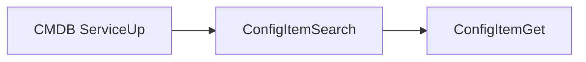
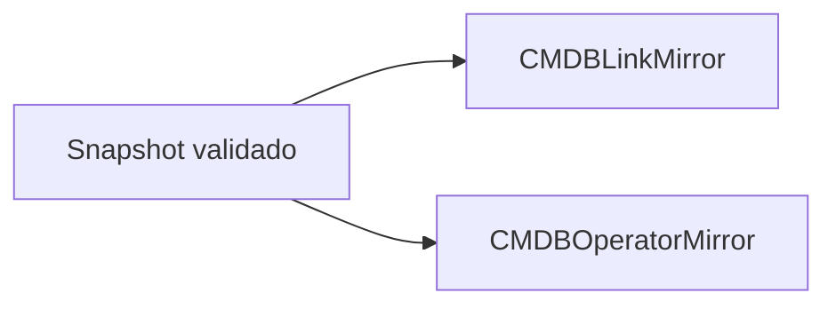
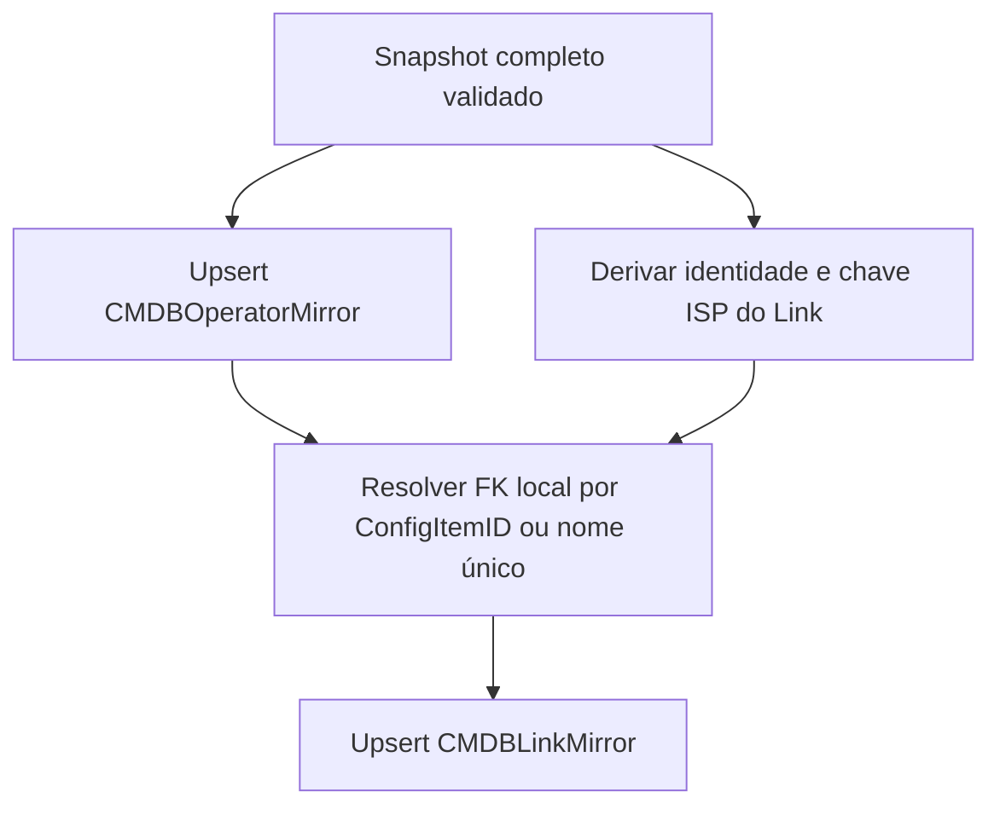
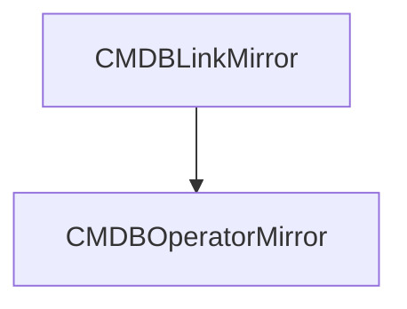
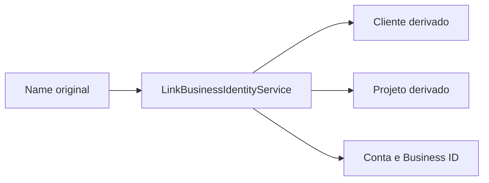

# CMDB

{{badge:CMDB}} {{badge:REMOTE}} {{badge:MIRROR}} {{badge:READ-ONLY}} {{badge:RECONSTRUÍVEL}}

> **Somente leitura:** o conector consulta os ConfigItems da CMDB. A sincronização grava no banco ARION, não altera os objetos oficiais.

> **Fonte da verdade:** CMDB continua sendo a fonte oficial do ConfigItem, incluindo seus atributos mapeados. Campos de cliente/projeto que o ARION deriva de Name são interpretações auxiliares, não novos cadastros oficiais.

## Fluxo de leitura

`CMDBClient` usa GenericInterface ServiceUp com operações `CMDB/ConfigItemSearch` e `CMDB/ConfigItemGet`. `CMDBSyncService` procura o conjunto de IDs sem limite artificial, carrega detalhes em lotes e valida identidade, classe e completude antes de reconciliar presença. Classe parcial, ID duplicado, classe inesperada ou Get incompleto cancela a aplicação; não marca todos os registros não vistos como removidos.

As classes realmente consumidas são `Links de internet` e `Operadoras`. Não há geocodificação nem consulta externa por request: Base, Dashboard, Mapa, Cockpit e Rankings leem o mirror local.

O service prepara as duas classes, grava os mirrors de Provider/ISP e depois atribui a FK local dos Links. `LinkBusinessIdentityService` calcula apenas os campos derivados do Link; não altera o `name` de origem.

## Identificadores

| Campo | Origem | Uso |
|---|---|---|
| `ConfigItemID` → `source_config_item_id` | Chave técnica do ConfigItem | Upsert, referência do `OTRSTicketConfigItem.config_item_id` e resolução de Provider. Unique no mirror. |
| `Number` → `source_number` | Número de exibição/negócio | Busca e apresentação; nullable e unique quando existe. Não é chave de join do Ticket–CI. |
| `Name` → `name` | Nome original do ConfigItem | Exibição e entrada do parser de identidade. O valor original é preservado. |

## Classes e campos mapeados

| Grupo | CMDB Link — campos do mirror | CMDB Provider/ISP — campos do mirror |
|---|---|---|
| Identidade | `ConfigItemID`, `Number`, `Name`, `Class` (classe também é validada) | `ConfigItemID`, `Number`, `Name`, `Class` |
| Localização | `Cidade`, `Estado`, `Endereco` | — |
| Link e circuito | `Circuito`, `Designacao`, `DesignacaoOperadora`, `Identificacao`, `Tipo`, `Velocidade`, `RangeIP`, `Equipamento`, `MACAddress` | — |
| Cliente/contrato | `CNPJ`, `CnpjOperadora`, `NumeroContrato`, `CustomerID`, `HorarioFuncionamento` | `CategoriaOperadora`, `CnpjOperadora`, `HorarioOperadora` |
| Provider / contato | `ISP` raw → `isp_raw` + FK `operator`; `ObservacaoISP` → `isp_notes` | `TelefoneOperadora`, `OperadoraWhatsApp`, `EmailAbertura`, `EmailAcompanhamento`, `PortalOperadora`, `1..5EscalonamentoOperadora` |
| Estado/versão | `CurDeplState`/`DeplState`, tipos, `CurInciState`/`InciState`, tipos, `DefinitionID`, `VersionID`, `LastVersionID`, `CreateTime` | Mesmos campos de estado/versão/timestamp para Provider |

Esses nomes são os valores de atributos CMDB consultados no `cmdb_sync.py`, não uma lista de todos os atributos disponíveis na instância. Campo de origem vazio permanece vazio no mirror; não é preenchido por inferência.

## Relação com Provider / ISP

`CMDBLinkMirror.operator` aponta para `CMDBOperatorMirror`, que representa semanticamente Provider/ISP na interface. O nome histórico do campo é `operator`; não prova que o Provider seja a empresa contratada. A resolução usa `isp_raw` primeiro como `source_config_item_id`; como fallback, tenta nome exato único. Sem match ou com match ambíguo, preserva o raw e deixa a FK nula com método `UNRESOLVED`/`EMPTY`.

A FK `operator` é nullable e `SET_NULL`: apagar um registro local de Provider não apaga o Link mirror. A sincronização normal reconstrói/atualiza as classes e mantém a relação por ConfigItemID.

## Business identity

### Cliente, Projeto, Conta, Business ID e Provider

Esses conceitos são campos distintos:

| Conceito | Representação | Como é obtido | Relação |
|---|---|---|---|
| Cliente contratante | `contracting_client` | Regra textual sobre segmentos do `Name`; clientes reconhecidos incluem Claro/TELMEX, Vivo/Telefônica e Algar; aliases configuráveis podem mapear o segmento explícito | Não é Provider e não é `CustomerID` |
| Projeto | `business_project` | Alias explícito de projeto; fallback para segmento comercial adjacente somente conforme regra do parser | Distingue o agrupamento de negócio do Cliente |
| Conta | `business_account` | Segmento remanescente quando a composição de nome é inequívoca | Só é preenchida se restar exatamente um segmento elegível |
| Business ID | `business_id` | Token `BD...dígito...` ou `BL...dígito...` extraído de `Name` | Identificador interpretado, não `ConfigItemID` nem `Number` |
| Provider / ISP | `CMDBOperatorMirror` via FK local `CMDBLinkMirror.operator` | ConfigItem da classe `Operadoras`; o Link resolve primeiro por `ConfigItemID` e depois por nome exato único | Entidade de fornecedor de conectividade; não substitui Cliente nem Projeto |
| Customer ID | `customer_id` | Campo de origem `CustomerID` no Link, quando fornecido | Mantido separado da Conta derivada |

O parser separa `Name` pelos delimitadores hífen, meia-risca e travessão; compara texto sem acento e sem diferença de caixa, mas preserva `name` original. Os aliases de cliente são Claro/TELMEX → Claro, Vivo/Telefônica → Vivo e Algar → Algar; `ARION_LINK_CLIENT_ALIASES` pode fornecer alias local para o segmento explicitamente reconhecido.

| Tokens de projeto aceitos | Nome canônico | Inferência de cliente no parser |
|---|---|---|
| Correios, Banco do Brasil, Caixa Econômica/CEF, Carrefour | Correios, Banco do Brasil, Caixa Econômica Federal, Carrefour | Claro |
| FUST, L2L, Arcos Dourados e variantes McDonald’s | Fust, L2L, Arcos Dourados | Vivo |
| Escolas Conectadas | Escolas Conectadas | Algar |
| BRAD/Bradesco, Diversos e variantes “Projeto(s) Diversos” | Bradesco, Diversos | Compartilhado; não escolhe cliente por projeto |

Aliases sem correspondência permanecem como texto de projeto no fallback adjacente, se houver cliente explícito e se o segmento não for prefixo regional `CLARO.<UF>` nem `TELMEX`. Business ID é token com prefixo BD ou BL e pelo menos um dígito, podendo conter outros caracteres alfanuméricos. Se somente esse token for encontrado com fonte `UNKNOWN`, a confiança continua LOW. Conta vazia é correta quando restam zero ou vários segmentos.

`LinkBusinessIdentityService` interpreta segmentos de `name` e grava os campos derivados separados do original:

| Campo derivado | Significado |
|---|---|
| `contracting_client_raw` | Segmento de cliente reconhecido no nome, sem perder o texto identificado. |
| `contracting_client` | Cliente canônico, segundo regras atuais (Claro, Vivo ou Algar). |
| `business_project` | Projeto reconhecido por alias ou regra de segmento. |
| `business_account` | Segmento remanescente associado à conta quando a estrutura é inequívoca. |
| `business_id` | Token que corresponde ao padrão configurado `BD`/`BL` com dígito. |
| `business_identity_confidence` | HIGH com cliente, projeto e ID; MEDIUM se ao menos um aparece; LOW sem classificação. Se a origem for UNKNOWN, o código força LOW mesmo com um token isolado. |
| `business_identity_source` | Origem da regra, como `CMDB_EXPLICIT_CLIENT`, `CMDB_PROJECT_RULE` ou UNKNOWN. |

Exemplo estrutural, não extraído de cadastro real: `CLARO – DIVERSOS – CONTA EXEMPLO – BD123` pode resultar em Cliente Claro, Projeto Diversos, Conta Exemplo e Business ID BD123 quando os segmentos satisfazem a regra atual. A lista de aliases inclui projetos compartilhados como Bradesco e Diversos; aliases associados a cliente inferem essa dimensão só quando a regra do parser prevê esse cliente. O fallback adjacente não trata prefixos regionais `CLARO.<UF>` nem `TELMEX` como nome de projeto.

> **Importante:** `TELMEX` é alias/contexto para Cliente Claro quando aparece junto de Claro e não é tratado como Projeto. O parser exclui esse token da seleção de projeto; não remova essa distinção em uma futura normalização.

Esses atributos são interpretação ARION do nome, não campos oficiais independentes da CMDB. `legacy_project` é uma fonte histórica separada de XLSX; só serve como fallback de escopo quando `business_project` está vazio. Não é atualizado pelo sync CMDB.

## Campos que não entram no mirror

O sincronizador grava uma whitelist explícita em `OPERATOR_FIELDS`/`LINK_FIELDS`. Atributos não mapeados são ignorados; logs de integração podem indicar apenas o nome do campo ignorado. `UsuarioPPOE` é admitido na lista de atributos observáveis, mas não há campo correspondente no mirror atual, portanto não é persistido. Outros atributos de contato não aparecem no mirror se não estiverem na whitelist/model.

`CMDBClient` filtra nomes associados a password/senha, credential, secret, token, auth, cookie, session e usuário de portal antes de devolver itens sanitizados. Senhas PPPoE/portal não são armazenadas. `CMDBOperatorMirror` contém URL do portal e contatos de operação autorizados pelo mapeamento, nunca credencial de login. Não enviar valores brutos de contato/portal a logs, documentação ou resposta administrativa.

## Freshness e estado

`is_present_in_source=True` define objeto presente na última reconciliação válida. `source_last_seen_at`/`source_synced_at` e `IntegrationSyncState` ajudam a interpretar freshness. Worker executa CMDB FULL a cada 10 min. Falha conserva último snapshot; a web continua atendendo com dados possivelmente stale.

## Implementação no repositório

| Arquivo | Responsabilidade |
|---|---|
| `arion_geo/aplicativos/integracoes/clients/cmdb.py` | Endpoints Search/Get, transporte HTTP, parsing e sanitização. |
| `arion_geo/aplicativos/integracoes/services/cmdb_sync.py` | Classes, whitelist de campos, validação de snapshot, resolução Provider e upsert. |
| `arion_geo/aplicativos/integracoes/services/link_business_identity.py` | Parse de Cliente, Projeto, conta, ID, confiança e origem. |
| `arion_geo/aplicativos/integracoes/models.py` | `CMDBLinkMirror` e `CMDBOperatorMirror`, constraints, fields e índices. |
| `arion_geo/aplicativos/integracoes/test_mirror_sync.py` | Testes de sincronização/mirror sem escrita remota. |

## Veja também

[OTRS](OTRS.md), [Banco e Models](BANCO-DE-DADOS.md), [Dicionário](DICIONARIO-DE-DADOS.md), [Worker](WORKER-E-SINCRONIZACAO.md), [Base](funcionalidades/base.md), [Mapa](funcionalidades/mapa.md), [Rankings](funcionalidades/rankings.md), [Chamados](funcionalidades/chamados.md) e [Data Scope](funcionalidades/usuarios-grupos-escopos.md).
