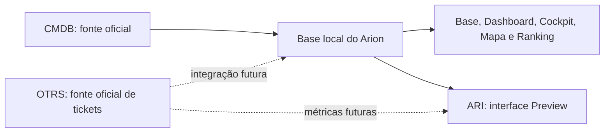

# ARION ATACADO GEO

## Apresentação

O ARION ATACADO GEO é uma plataforma Django de inteligência operacional para o NOC Atacado. Centraliza consulta, análise, exploração e visualização de dados para apoiar o trabalho diário. O sistema mantém uma camada local de consulta sobre dados operacionais e não substitui os sistemas de registro oficiais.

## Objetivos e princípios

O Arion reduz a fragmentação das consultas, reúne visões operacionais, apresenta indicadores e dá suporte a análises interativas. A CMDB/OTRS permanece fonte oficial; o banco local é espelho sincronizado, cache operacional e camada analítica. Métricas demonstrativas são identificadas como DEMO e não devem ser confundidas com métricas reais.

## Módulos

| Módulo | Finalidade | Estado |
|---|---|---|
| Início | Acesso às áreas autorizadas. | Implementado. |
| Base de Links | Consulta e atualização do espelho CMDB. | XLSX operacional. |
| Dashboard | Visão executiva CMDB e indicadores demonstrativos. | Implementado; métricas de tickets DEMO. |
| Cockpit | Consulta analítica, filtros, Saved Views e exportações. | Implementado; métricas operacionais DEMO. |
| Mapa | Agregações geográficas por UF. | CMDB real e indicadores DEMO. |
| Ranking de Provedores | Compara provedores com atributos CMDB e performance DEMO. | Implementado. |
| ARI | Conversas, anexos e artifacts demonstrativos. | Preview sem LLM integrado. |
| Configurações e Auditoria | Conta, acesso, escopos e rastreabilidade. | Implementado conforme permissões. |

## Segurança e tecnologia

O sistema usa autenticação Django, Groups/Permissions (RBAC) e Data Scope aplicado no backend. `GroupDataScope` limita dados CMDB por grupo. A aplicação usa Python 3.12, Django 5.2, templates, CSS e JavaScript vanilla; SQLite está configurado no desenvolvimento atual. Integrações reais com API CMDB e tickets OTRS são futuras.

## Documentação

Comece pelo [índice oficial](README.md), depois consulte [Estado Atual](ESTADO-ATUAL.md), [Arquitetura](ARQUITETURA.md) e [Fontes de Dados](FONTES-DE-DADOS.md).
