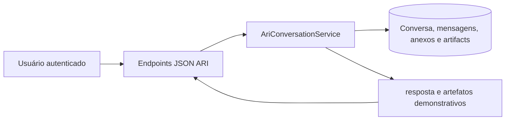

# ARI

## Visão geral e estado atual

ARI é uma interface autenticada de conversas e recursos demonstrativos. O estado atual não integra LLM, API externa, OTRS ou CMDB para gerar respostas. Conversas, mensagens, anexos e artifacts são persistidos no banco; resultados analíticos demonstrativos não devem ser tratados como dados oficiais.

## Dados e isolamento

`AriConversation` pertence a um usuário e usa UUID. `AriMessage` pertence à conversa e identifica `user` ou `assistant`; `metadata` guarda metadados. `AriAttachment` relaciona arquivo privado à conversa e mensagem, guardando nome original, MIME e tamanho. `AriArtifact` guarda metadados de relatório/dashboard HTML demonstrativo ligado à conversa e mensagem.

As consultas de conversa e artifact verificam propriedade pelo usuário autenticado. Downloads também exigem vínculo com conversa própria; UUID não substitui autorização. A tela está em `/ari/`, com histórico de conversas do usuário.

## Mensagens, arquivos e endpoints

| Endpoint | Método | Finalidade |
|---|---|---|
| `/ari/api/conversations/` | POST | Cria conversa e envia mensagem inicial. |
| `/ari/api/conversations/<uuid>/` | GET | Consulta conversa própria. |
| `/ari/api/conversations/<uuid>/messages/` | POST | Envia mensagem e anexos à conversa. |
| `/ari/api/conversations/<uuid>/rename/` | POST | Renomeia conversa própria. |
| `/ari/api/conversations/<uuid>/delete/` | POST | Remove conversa própria. |
| `/ari/attachments/<uuid>/download/` | GET | Baixa anexo autorizado. |
| `/ari/artifacts/<uuid>/` | GET | Exibe artifact autorizado. |

`AriConversationService.send_message()` valida anexos antes de persistir. São aceitos PDF, XLSX, CSV, TXT, DOCX e imagens suportadas pela validação; extensão, MIME, conteúdo e limite são verificados. O limite configurável padrão é 20 MiB por arquivo. Conteúdo de arquivo não é analisado semanticamente nesta versão Preview. Erro de arquivo inválido retorna 400; arquivo acima do limite retorna 413. API exige autenticação, permission `view_ari` e JSON ou multipart/form-data conforme a operação.

## Segurança, auditoria e testes

Uploads ficam em storage privado e downloads passam pela view autorizadora. Conversas e anexos não devem ser incluídos em logs técnicos. Leitura comum não é auditada. Testes de `aplicativos.ari` cobrem propriedade de conversas, endpoints, validação/limites de anexos, download e artifacts.

### Implementado

Conversas, histórico, envio de mensagens, anexos privados e artifacts demonstrativos.

### Futuro

Integração com IA real e fontes externas depende de implementação posterior; não existe nesta versão.
