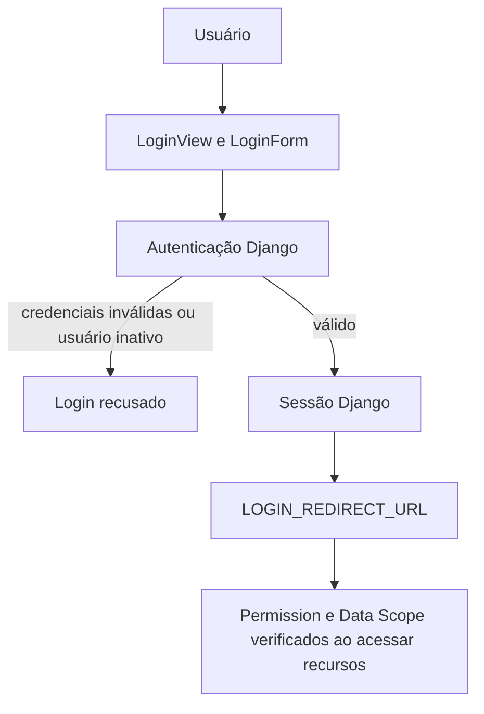

# Autenticação e Sessão

## Visão geral

O app `autenticacao` usa autenticação nativa do Django para reconhecer usuários e manter sessão. Autenticação, permission e Data Scope são controles diferentes: login confirma a identidade; Groups/Permissions autorizam ações; escopo limita registros operacionais. Veja [Usuários, Grupos e Escopos](usuarios-grupos-escopos.md).

## Login e sessão

`LoginView` usa `LoginForm` em `/login/`, com os campos de identificação configurados pelo formulário e senha Django. A autenticação padrão rejeita credenciais inválidas e contas inativas. Após login, `LOGIN_REDIRECT_URL` aponta para `painel:index`; usuário autenticado que abre login é redirecionado. Rotas protegidas sem sessão usam `LOGIN_URL` e retornam ao login com destino de retorno.

O projeto usa sessions e middleware do Django. Não define duração customizada de sessão nas configurações consultadas; expiração segue a configuração padrão do Django/deployment. Logout é `LogoutView` em `/logout/` e encerra a sessão, redirecionando para `LOGOUT_REDIRECT_URL` (`autenticacao:login`).

Falhas de login geram `LOGIN_FAILED` sem registrar senha; login e logout bem-sucedidos geram `LOGIN_SUCCESS` e `LOGOUT`. Autenticação válida não concede automaticamente permissões nem dados. Conta comum sem grupo pode autenticar, mas tem acesso operacional restritivo.

## URLs e componentes

| URL | Método | Finalidade |
|---|---|---|
| `/login/` (`autenticacao:login`) | GET, POST | Exibe formulário e autentica. |
| `/logout/` (`autenticacao:logout`) | POST | Encerra sessão. |

`LoginForm` adapta o formulário Django; `LoginView` e `LogoutView` implementam os fluxos. Signals de `aplicativos.auditoria` registram eventos de autenticação. Os testes cobrem sucesso, falha, usuário inativo, logout e eventos. Não há MFA ou política de expiração própria documentada. Erros de sessão/CSRF seguem [tratamento global de erros](tratamento-global-erros.md).

## Identidade do login e avisos de versão

O template de login aplica a identidade ARION OPS, com carrossel institucional de três artes. A página não inclui o aviso, o indicador, nem os botões de atualização. Após autenticar, o shell consulta `/api/version/` sem cache e observa o Service Worker em espera.

A versão pendente e a versão dispensada são guardadas no `localStorage`, cada uma pelo identificador de versão. Navegação e F5 preservam o aviso; Depois fecha o toast e mantém um indicador global para acesso posterior. Uma nova versão não herda a dispensa. Atualizar agora mantém o fluxo `SKIP_WAITING` atual; quando o controller muda, o estado local antigo é removido e a página recarrega. O catálogo em `docs/releases/releases.json` continua sendo a fonte canônica, sem alteração de release ou versão publicada nesta etapa.
