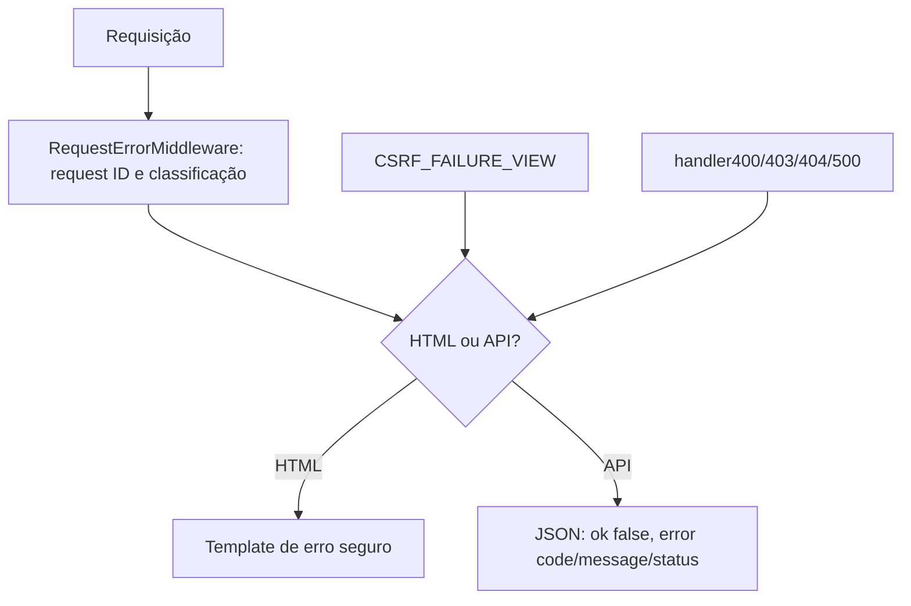

# Tratamento Global de Erros

## Arquitetura

`config.errors` centraliza catálogo, helpers JSON, renderização HTML e handlers. `RequestErrorMiddleware` atribui `REQ-` por requisição, expõe `X-Request-ID`, reconhece APIs pela rota/caminho e padroniza falhas JSON. Não usa o header `Accept` como única identificação. Páginas usam `errors/error.html` e `errors/base_error.html` sem layout global, context processors ou CDN.

## Códigos e comportamento

| Status | Código(s) | Estado |
|---|---|---|
| 400 | `BAD_REQUEST`, `ATTACHMENT_INVALID` | Ativo para requisição inválida e arquivo ARI inválido. |
| 401 | `AUTHENTICATION_REQUIRED` | Ativo para API protegida sem sessão; páginas HTML continuam redirecionando ao login. |
| 403 | `ACCESS_DENIED`, `CSRF_FAILED` | Ativo para permissão negada e falha CSRF. |
| 404 | `NOT_FOUND` | Ativo para rota/recurso não encontrado. |
| 405 | `METHOD_NOT_ALLOWED` | Normalizado; API JSON, preserva `Allow`. |
| 413 | `FILE_TOO_LARGE`, `ATTACHMENT_TOO_LARGE` | Ativo para limite de arquivo excedido. |
| 415 | `UNSUPPORTED_MEDIA_TYPE` | Ativo quando API exige tipo de mídia específico. |
| 422 | `VALIDATION_ERROR` | Catálogo pronto; views tradicionais podem manter 400. |
| 408, 409, 429 | `REQUEST_TIMEOUT`, `CONFLICT`, `RATE_LIMITED` | Suporte preparado, sem timeout de domínio ou rate limiter implementado. |
| 500 | `INTERNAL_ERROR`, `EXPORT_FAILED` | Ativo; resposta segura em produção. |
| 502, 503, 504 | `BAD_GATEWAY`, `INTEGRATION_*`, `SERVICE_UNAVAILABLE`, `GATEWAY_TIMEOUT` | Padrões preparados; 502/504 podem ocorrer no proxy antes do Django. |

`handler400`, `handler403`, `handler404` e `handler500` estão configurados. `CSRF_FAILURE_VIEW` usa `csrf_failure`, apresenta mensagem amigável e não inclui a razão técnica na página. Os erros de upload ARI estão descritos em [ARI](ari.md).

## DEBUG, logging e privacidade

Com `DEBUG=False`, HTML e JSON não expõem exception, traceback, SQL ou configurações. Com `DEBUG=True`, páginas HTML 500 mantêm diagnóstico técnico do Django; APIs continuam recebendo JSON seguro. Logs operacionais incluem request ID, usuário quando disponível, método, caminho sem query string e status/erro. O logger padrão de traceback bruto do Django é suprimido em favor do registro sanitizado.

O middleware e handlers não registram corpo, cookies, tokens ou credenciais da requisição. Falhas técnicas e CSRF não geram `AuditEvent`; auditoria funcional é separada do logging técnico. Erros 404 comuns também não criam eventos de auditoria.

## Assets e testes

Templates independentes carregam CSS local (`static/css/errors.css`) e JavaScript de `frontend_src/js/errors.js` e `frontend_src/js/theme.js`, resolvidos pelo template tag ``. O tema é obtido no navegador; a interface responde a claro/escuro e telas pequenas.

Testes em `aplicativos.configuracoes.test_errors` cobrem 400, 401 API, 403, 404, 405, 500, CSRF, formato JSON, preservação de detalhes em DEBUG para HTML e ausência de segredos nas respostas de produção. Não há rate limiting, modo de manutenção, health check ou configuração de páginas de proxy implementados.
