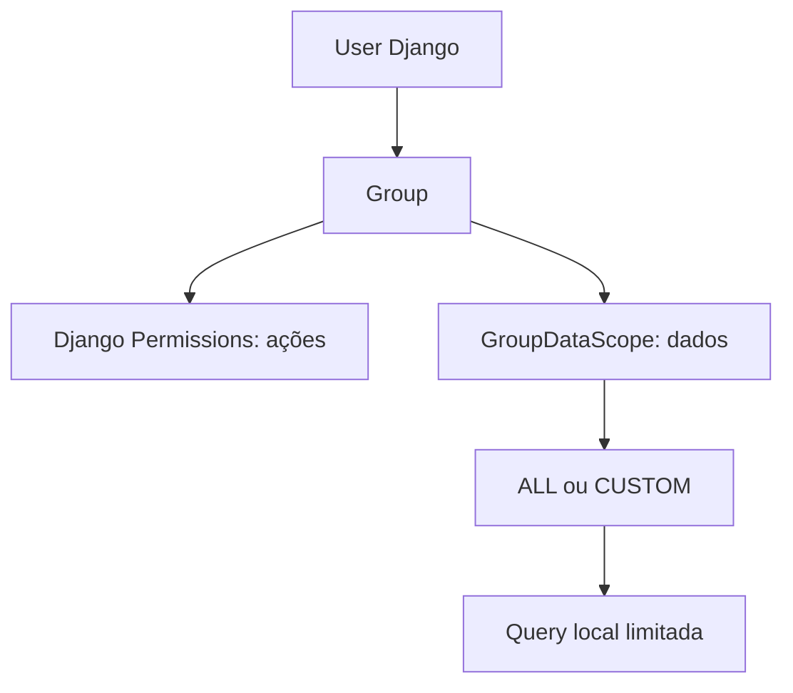
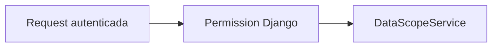
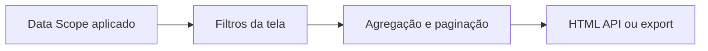

# Usuários, Grupos e Escopos de Dados

## RBAC e Data Scope

RBAC responde que ações a pessoa pode executar e usa Django Groups/Permissions. Data Scope responde quais linhas ela pode consultar e é aplicado no backend antes de filtros, agregações, paginação, detalhes, APIs e exports. Os dois controles são independentes.

## Grupos e permissões

`bootstrap_access` provisiona grupos: Administrador do Sistema, Gestor, Analista NOC e Consulta / Auditoria. Os codenames e grants vêm de `access_control.py`; não existe regra por username nem `user.role`. O formulário da Central configura o grupo principal; as views conferem permissions no backend ainda que um link esteja oculto.

Django permite múltiplos grupos. Permissions funcionais concedidas pelos grupos seguem Django Auth. Para dados, scopes CUSTOM de cada grupo são acumulados com interseção AND. Um grupo com ALL não remove restrição CUSTOM de outro.

## `GroupDataScope`

OneToOne com Group, modo `ALL`/`CUSTOM`, M2M `allowed_operators` e `allowed_projects`. Os catálogos de escopo são dimensões administrativas e não significam automaticamente Provider/ISP.

- ALL remove restrição adicional de linhas, mas não concede permission funcional.
- CUSTOM exige simultaneamente Cliente/operadora permitida E Projeto permitido.
- CUSTOM sem itens autorizados produz queryset vazio.
- Ausência de scope em qualquer grupo torna o acesso de dados restritivo.
- Superuser técnico é global e não precisa de scope.

Para `CMDBLinkMirror`, filtro usa `contracting_client` ou valor raw autorizado e `business_project`. `legacy_project` só entra como fallback quando `business_project` está vazio; caso contrário poderia ampliar escopo entre projetos. As duas dimensões são AND. Para model legado `base_links.CMDBLink`, filtros usam IDs `operadora_id` e `projeto_id`.

## Fluxo e administração

Administração de Usuários, Grupos e Escopos fica em `/configuracoes/administracao/` e requer `manage_users`, `manage_groups` ou `manage_data_scopes`. Django `/admin/` é manutenção técnica. Data Scope controla dados operacionais; não substitui RBAC.

`LegacyUserDataScope` preserva configuração individual anterior e não é fonte atual de consulta. Migração para scope por grupo manteve defaults restritivos quando escopos não eram consistentes. Auditoria registra mudanças relevantes sem senha. Testes cobrem ALL/CUSTOM, interseção, scope ausente/vazio, multi-grupo e superuser.
