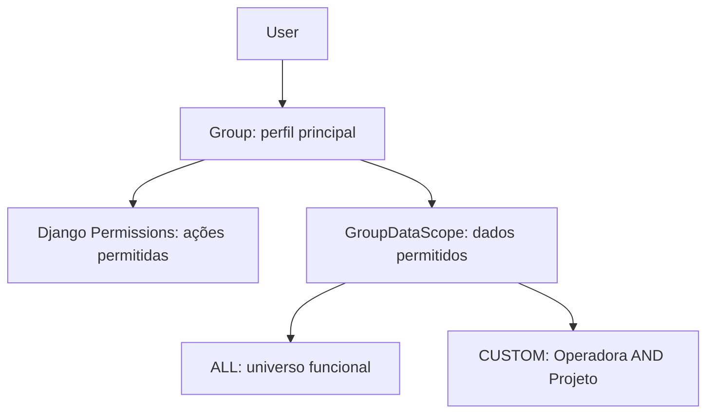

# Usuários, Grupos e Escopos de Dados

## Modelo de acesso

O modelo operacional oficial associa permissões funcionais e dados disponíveis ao perfil do usuário:

`User` autentica a pessoa e contém campos de identidade e estado ativo. A interface do Arion trabalha com um grupo operacional principal; trocar o grupo substitui a associação anterior e troca conjuntamente permissions e Data Scope herdados. Contas inativas não podem autenticar. Criação/edição usa forms Django e senha inicial é tratada pela autenticação Django, sem armazenamento de senha em claro.

## Grupos e permissions

Django `Group` representa o perfil operacional e reúne Permissions Django. A interface permite editar permissões autorizadas e exige um grupo ao criar usuário comum. Perfis iniciais são provisionados pelo comando `bootstrap_access`; a autorização funcional continua sendo validada no backend.

## `GroupDataScope`

`GroupDataScope` é OneToOne com `Group` e contém `mode`, `allowed_operators` e `allowed_projects`. Não há escopo individual ativo como fonte oficial para consultas comuns.

- **ALL:** permite o universo operacional disponível pelas permissions do usuário; não transforma usuário em superuser.
- **CUSTOM:** requer que cada registro corresponda simultaneamente a operadora permitida **e** projeto permitido.
- **CUSTOM vazio:** sem operadoras ou sem projetos selecionados, o resultado é vazio; lista vazia nunca significa ALL.
- **Sem grupo/configuração:** usuários comuns recebem zero registros operacionais.
- **Superuser:** tem bypass global técnico de Data Scope.

`DataScopeService.filter_queryset()` aplica essas regras no QuerySet do backend antes de filtros, agregações, indicadores e paginação. Ocultar opções no frontend não é controle de segurança.

## Legado e migração

`LegacyUserDataScope` preserva configurações individuais anteriores à migração; não é a fonte usada pelas consultas atuais. A migração transfere para o grupo quando os escopos legados dos membros são consistentes. Grupos sem uma configuração comum recebem `CUSTOM` vazio; os dados legados permanecem preservados para referência, sem inferir permissões amplas.

## Auditoria e testes

Alterações relevantes podem gerar `USER_CREATED`, `USER_UPDATED`, `GROUP_CHANGED`, `USER_ACTIVATED`, `USER_DEACTIVATED`, `PERMISSIONS_CHANGED` e `DATA_SCOPE_CHANGED`. Os eventos não incluem senhas. `aplicativos.auditoria.tests` e `aplicativos.configuracoes.tests` cobrem criação, troca de perfil, permissions, modos ALL/CUSTOM, interseção, escopo vazio, ausência de grupo e bypass de superuser.

### Estado

Usuários, grupos e escopos herdados estão implementados. `LegacyUserDataScope` é legado preservado. Não há pendência de negócio adicional documentada neste módulo.
